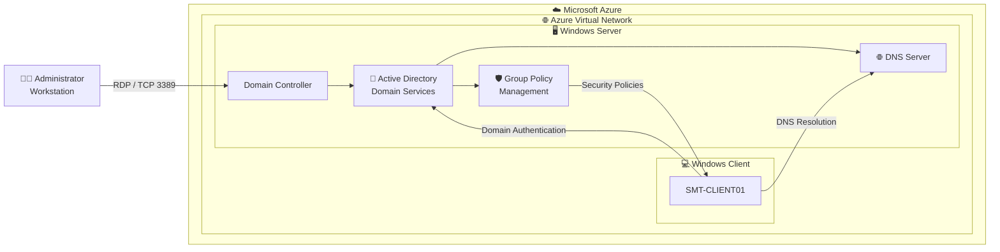

# Active Directory + Group Policy Security Lab

A hands-on Windows infrastructure and security project demonstrating how I built, integrated, secured, managed, and validated an **Active Directory Domain Services environment hosted on Microsoft Azure**.

---

## 📌 Project Overview

This project demonstrates the implementation of a Windows domain environment using:

- [x] [Microsoft Azure](https://github.com/ShaunTeka/azure-cloud-portfolio/tree/main/azure-vm-deployment)
- [ ] Windows Server
- [ ] Active Directory Domain Services
- [ ] DNS
- [ ] Windows 11
- [ ] Group Policy
- [ ] Microsoft Defender
- [ ] Windows Defender Firewall
- [ ] Windows File Services
- [ ] PowerShell

The project follows five infrastructure phases:

```text
BUILD
  ↓
CONNECT
  ↓
SECURE
  ↓
MANAGE
  ↓
VALIDATE
```

---

```
## 🏗️ Architecture

<br>


---

# Project Modules

## 01 — Active Directory Infrastructure

**BUILD**

Built the core Windows domain infrastructure, including **Active Directory Domain Services, DNS, Domain Controller services, Organizational Units, users, computers, and directory administration**.

📁 [View Active Directory Infrastructure](./active-directory-setup/)

**Demonstrates:** Windows Server · AD DS · DNS · Domain Administration

---

## 02 — Client Integration & Domain Join

**CONNECT**

Configured the Azure-hosted Windows client to use the Domain Controller for DNS, validated domain resolution and Domain Controller discovery, and successfully joined `SMT-CLIENT01` to the domain.

Key validation included:

```powershell
ipconfig /all
nslookup shaunmonwabisiteka.com
nltest /dsgetdc:shaunmonwabisiteka.com
```

📁 [View Client Integration & Domain Join](./client-domain-join/)

**Demonstrates:** Azure Networking · DNS · Windows Client · AD Integration · Troubleshooting

---

## 03 — Group Policy Security Hardening

**SECURE**

Implemented centralized Windows security controls through Group Policy, including:

- Password policies
- Account lockout protection
- Microsoft Defender configuration
- Windows Update management
- Removable-storage restrictions
- User-environment configuration

📁 [View Group Policy Security Hardening](./group-policy-security/)

**Demonstrates:** GPO · Identity Security · Endpoint Security · Security Administration

---

## 04 — File Services & Resource Access

**MANAGE**

Created departmental resources and explored centralized delivery of network shares.

```text
Finance
HR
IT
```

The project also demonstrates the relationship between:

```text
Active Directory Identity
        ↓
Security Groups
        ↓
Permissions
        ↓
Network Shares
        ↓
Drive Mapping
```

📁 [View File Services & Resource Access](./file-services/)

**Demates:** Windows File Services · Permissions · Group Policy Preferences

---

## 05 — Policy Validation & Evidence

**VALIDATE**

Verified that the Windows client successfully processed computer-side Group Policy.

Validation included:

```powershell
gpupdate /force
gpresult /h GPReport.html
```

The validation evidence demonstrated successful processing of the applicable domain policy on the managed client.

📁 [View Policy Validation](./validation/)

**Demonstrates:** GPUpdate · GPResult · Troubleshooting · Evidence-Based Validation

---

# 📊 Project Results

| Area | Result |
|---|---|
| Active Directory | Implemented |
| DNS | Configured and tested |
| Domain-joined client | Completed |
| Domain Controller discovery | Validated |
| Password security | Configured |
| Account lockout | Configured |
| Microsoft Defender | Configured |
| Windows Update | Configured |
| Removable storage controls | Configured |
| Department shares | Created |
| Drive mapping | Prepared |
| Group Policy validation | Completed |

---

# Skills Demonstrated

### Cloud Infrastructure
`Microsoft Azure` · `Azure VMs` · `Azure Networking` · `NSGs`

### Identity
`Active Directory` · `AD DS` · `DNS` · `Domain Controllers`

### Administration
`Group Policy` · `Windows Server` · `PowerShell`

### Security
`Microsoft Defender` · `Password Policy` · `Account Lockout` · `Endpoint Hardening`

### Networking
`DNS` · `IPv4` · `NICs` · `Domain Discovery`

### Validation
`ipconfig` · `nslookup` · `nltest` · `gpupdate` · `gpresult`

---

# Project Outcome

This project progressed from basic Windows infrastructure into a centrally managed Active Directory environment:

```text
BUILD
Active Directory + DNS
        ↓
CONNECT
Windows Client + Domain Join
        ↓
SECURE
Group Policy + Endpoint Controls
        ↓
MANAGE
Users + Resources
        ↓
VALIDATE
Client-Side Technical Evidence
```

The project demonstrates more than installation. It shows the ability to **build, connect, secure, administer, troubleshoot, and validate a Windows enterprise environment hosted in Microsoft Azure**.

---

## Key Takeaway

> **A successful Active Directory implementation is not just a Domain Controller. It requires reliable networking and DNS, managed endpoints, centralized security controls, controlled access to resources, and evidence that the intended policies are actually being applied.**
