# 📌 Project Overview

This project demonstrates how I built and secured a Windows Active Directory environment using **Microsoft Azure Virtual Machines, Windows Server, Active Directory Domain Services, DNS, and Group Policy**.

After completing the Active Directory setup, I used **Group Policy** to centrally manage security settings for domain-connected systems.

## Lab Navigation

Click any item below to jump directly to that section:

- [ Password Security](#password-security)
- [Account Lockout Protection](#account-lockout-protection)
- [Microsoft Defender Antivirus](#️microsoft-defender-antivirus)
- [Windows Defender Firewall](#windows-defender-firewall)
- [Windows Update Management](#windows-update-management)
- [Corporate Desktop Configuration](#corporate-desktop-configuration)
- [Removable Storage Restrictions](#removable-storage-restrictions)
- [Department Network Shares](#department-network-shares)
- [Group Policy Drive Mapping](#group-policy-drive-mapping)
- [Group Policy Validation and Reporting](#group-policy-validation-and-reporting)

---

# Group Policy Management

I used **Server Manager → Tools → Group Policy Management** to manage the domain's Group Policy settings centrally.

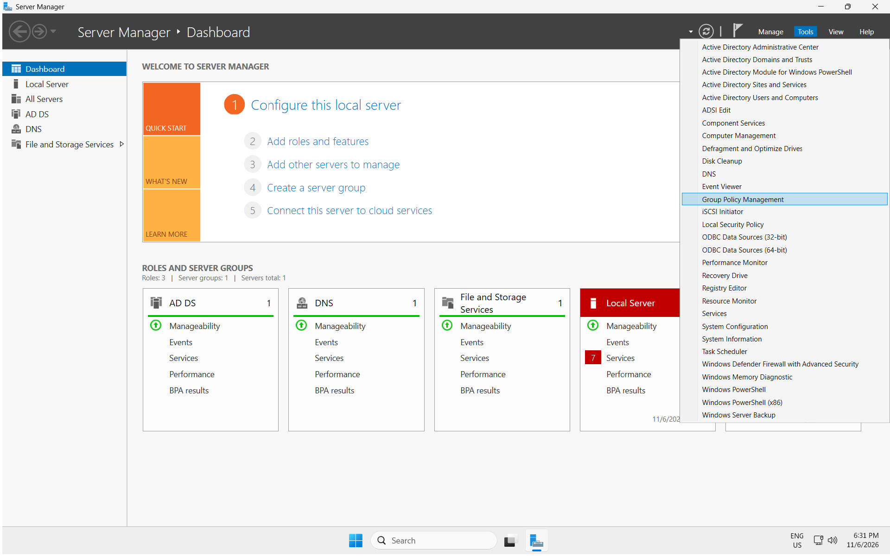

I then opened the **Default Domain Policy** for editing.

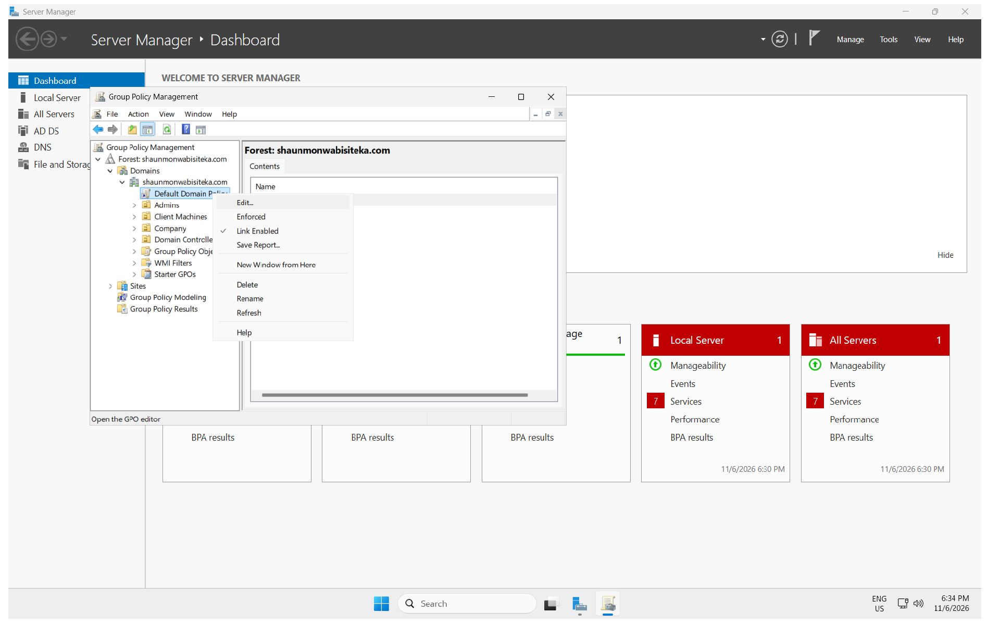

The main security path used throughout the lab was:

```text
Computer Configuration
└── Policies
    └── Windows Settings
        └── Security Settings
```

[Back to Lab Navigation](#-lab-navigation)

---

# Password Security

I configured domain-wide password controls through:

```text
Computer Configuration
→ Policies
→ Windows Settings
→ Security Settings
→ Account Policies
→ Password Policy
```

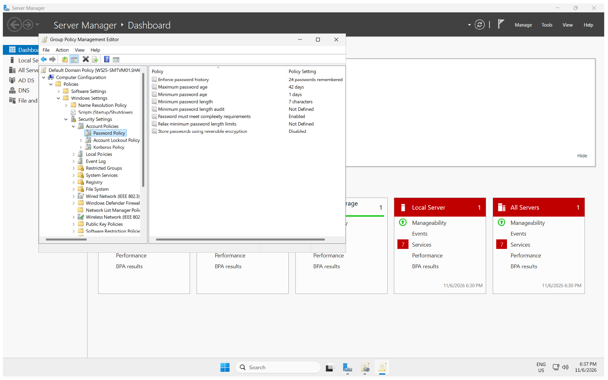

## Password History

```text
10 passwords remembered
```

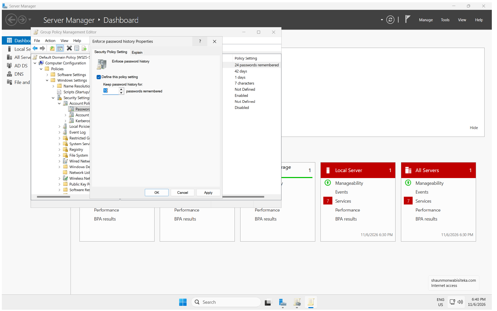

Prevents users from immediately reusing recently used passwords.

## Maximum Password Age

```text
90 days
```

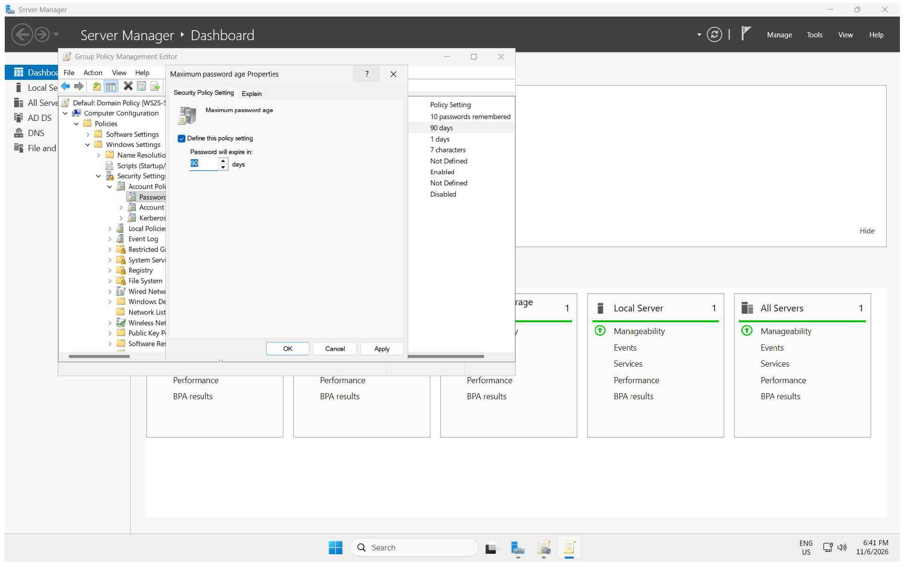

Used in this lab to demonstrate centralized password lifecycle management.

## Minimum Password Age

```text
1 day
```

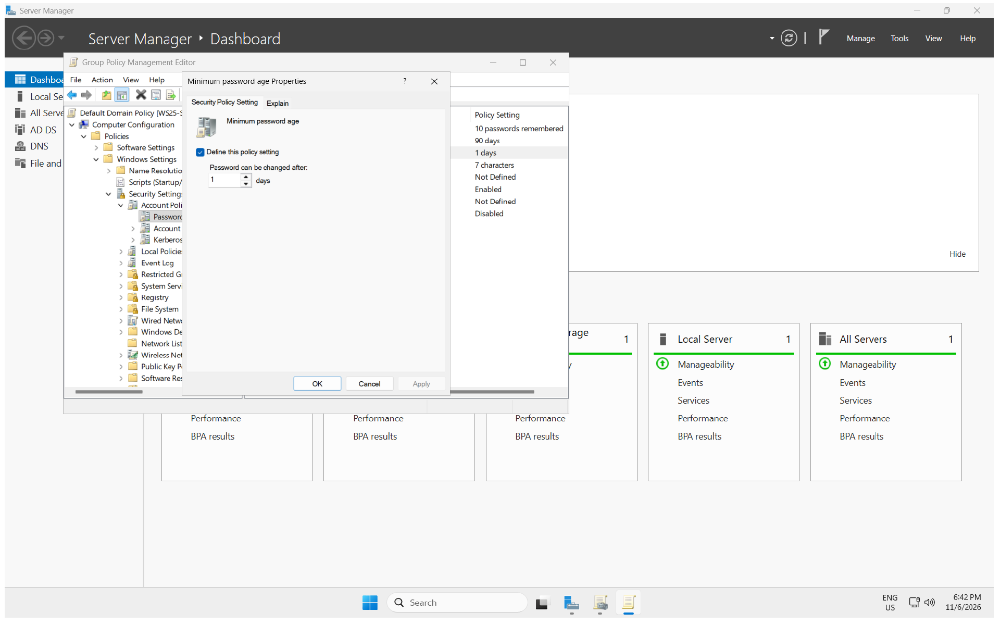

Prevents users from rapidly cycling through passwords to bypass password history.

## Minimum Password Length

```text
12 characters
```

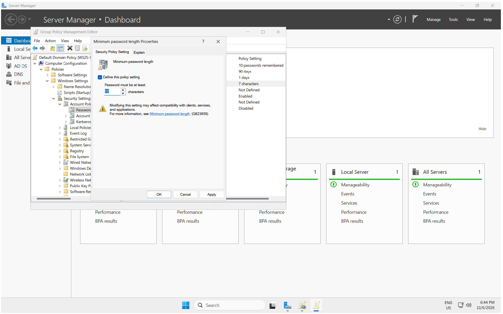

The final password configuration was:

| Policy | Configuration |
|---|---:|
| Password history | 10 passwords |
| Maximum password age | 90 days |
| Minimum password age | 1 day |
| Minimum password length | 12 characters |
| Password complexity | Enabled |
| Reversible encryption | Disabled |

[⬆️ Back to Lab Navigation](#-lab-navigation)

---

# Account Lockout Protection

I configured account lockout controls to reduce repeated password-guessing attempts.

## Account Lockout Threshold

```text
3 invalid logon attempts
```

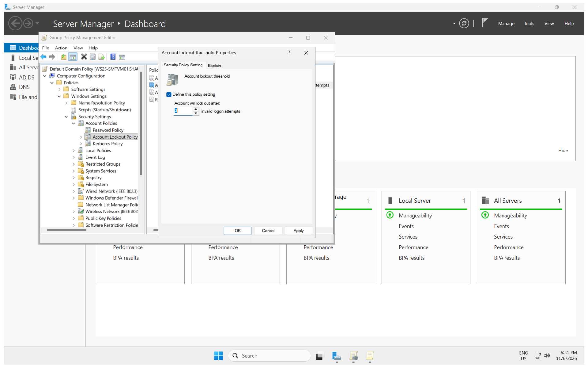

Windows also suggested related lockout settings:

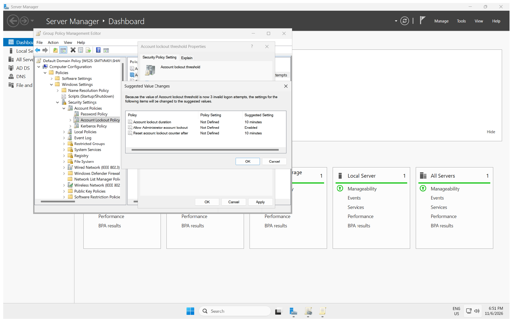

Final configuration:

| Policy | Configuration |
|---|---:|
| Account lockout threshold | 3 attempts |
| Account lockout duration | 10 minutes |
| Reset lockout counter | 10 minutes |
| Administrator account lockout | Enabled |

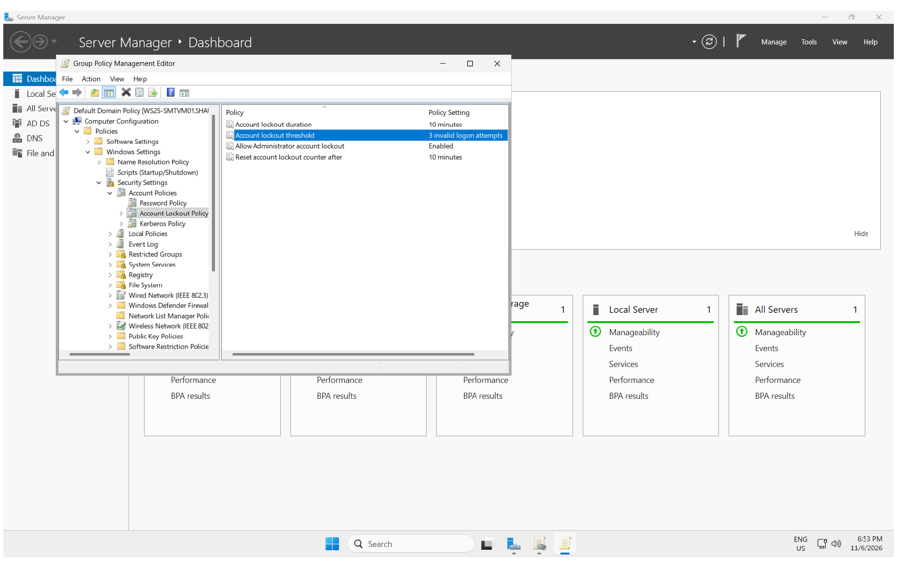

[⬆️ Back to Lab Navigation](#-lab-navigation)

---

# Microsoft Defender Antivirus

I configured Microsoft Defender settings using:

```text
Computer Configuration
→ Policies
→ Administrative Templates
→ Windows Components
→ Microsoft Defender Antivirus
→ Real-time Protection
```

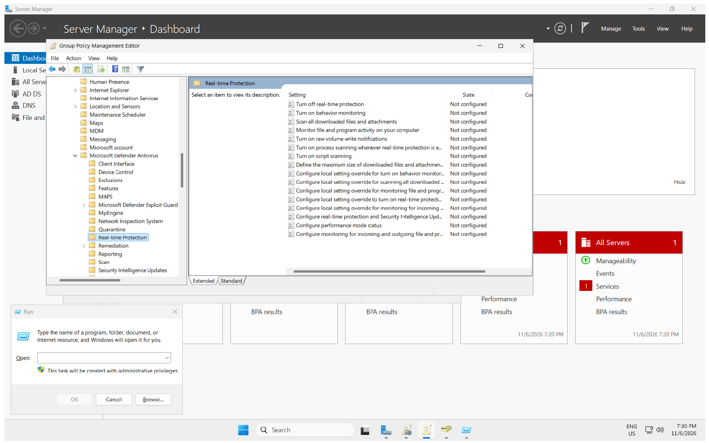

## Behavior Monitoring

I enabled:

```text
Turn on behavior monitoring
```

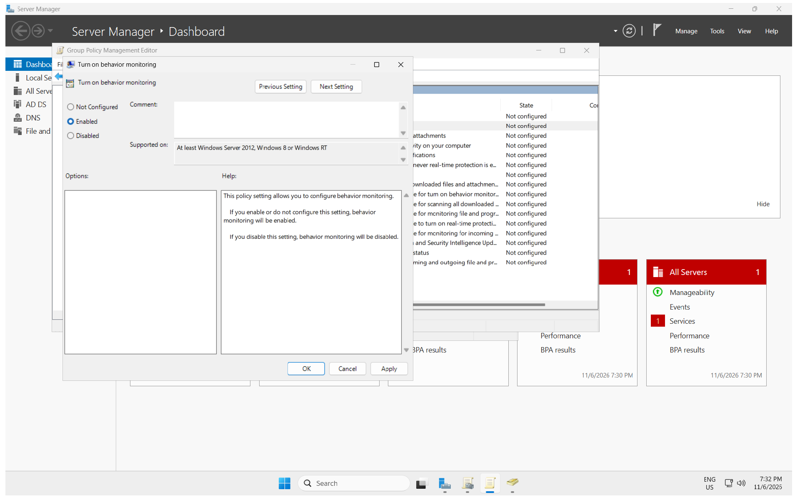

This provides additional endpoint protection by monitoring application and process behavior.

## File and Program Monitoring

I also configured monitoring for incoming and outgoing files and program activity.

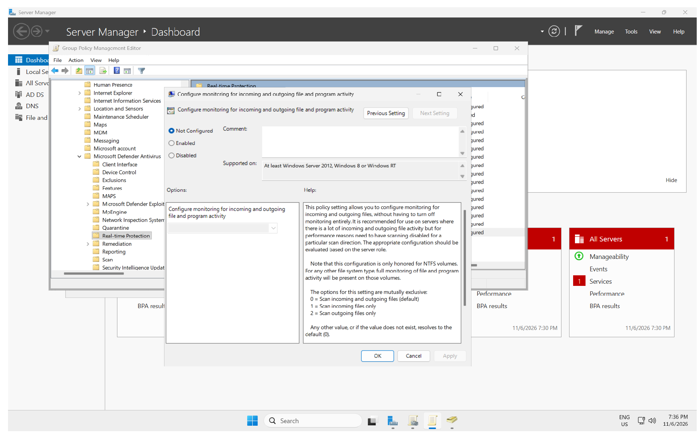

The final Group Policy Results report confirmed:

```text
Configure monitoring for incoming and outgoing
file and program activity → Enabled

Mode → Bi-directional (full on-access)

Turn on behavior monitoring → Enabled
```

[⬆️ Back to Lab Navigation](#-lab-navigation)

---

# Windows Defender Firewall

I explored centralized firewall management through:

```text
Computer Configuration
→ Policies
→ Windows Settings
→ Security Settings
→ Windows Defender Firewall with Advanced Security
```

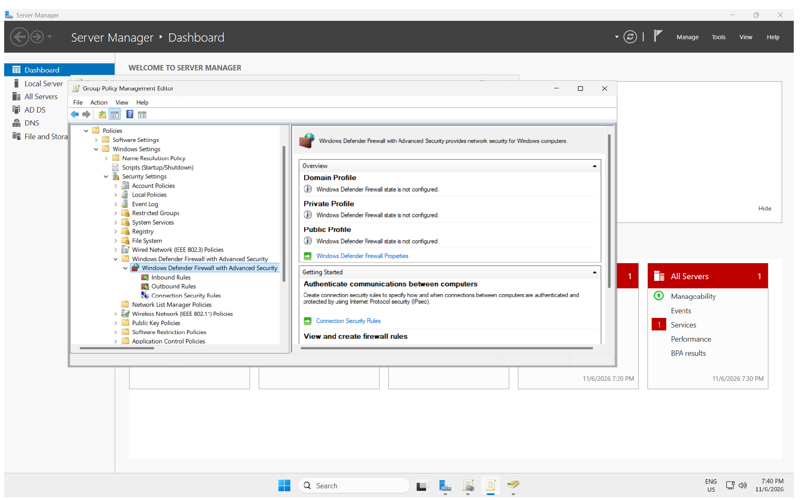

This area provides centralized management of:

- Domain Profile
- Private Profile
- Public Profile
- Inbound Rules
- Outbound Rules
- Connection Security Rules

> **Note:** The captured screenshot shows the firewall profiles as **Not Configured**. This section therefore demonstrates centralized firewall administration and policy discovery rather than claiming that firewall rules were enforced.

[⬆️ Back to Lab Navigation](#-lab-navigation)

---

# Windows Update Management

I configured Windows Update policies to demonstrate centralized patch-management control.

The validated computer policy included:

```text
Configure Automatic Updates
→ Enabled

Update Mode
→ Auto download and notify for install
```

### Feature Updates

```text
Deadline: 2 days
Grace Period: 7 days
```

### Quality Updates

```text
Deadline: 7 days
Grace Period: 2 days
```

This demonstrates how Group Policy can control update behaviour and update deadlines across managed Windows systems.

[⬆️ Back to Lab Navigation](#-lab-navigation)

---

# Corporate Desktop Configuration

I configured a corporate wallpaper through:

```text
User Configuration
→ Policies
→ Administrative Templates
→ Desktop
→ Desktop
→ es

I created departmental folders under:

```text
C:\DepartmentShares
```

Structure:

```text
DepartmentShares
├── Finance
├── HR
└── IT
```

./screenshots/19-department-shares.png

I then enabled file sharing for the IT department folder.

```text
Folder: IT
Share Name: IT
```

./screenshots/20-it-department-share.png

This creates the foundation for department-specific network resources.

```text
Active Directory User
        ↓
Security Group
        ↓
Department Permissions
        ↓
Network Share
        ↓
Drive Mapping
```

#-lab-navigation

---

# Group Policy Drive Mapping

I opened:

```text
User Configuration
→ Preferences
→ Windows Settings
→ Drive Maps
```

./screenshots/18-group-policy-drive-maps.png

Group Policy Preferences can automatically provide network shares to users.

For example:

```text
Finance Users → Finance Share
HR Users      → HR Share
IT Users      → IT Share
```

This demonstrates how Active Directory identity, file services and Group Policy can work together to provide resources automatically.

#-lab-navigation

---

# Group Policy Validation and Reporting

The final stage was **validation**.

I manually refreshed Group Policy on the client:

```powershell
gpupdate /force
```

I then generated a Group Policy Results report:

```powershell
gpresult /h GPReport.html
```

The report confirmed successful computer-side Group Policy processing on `SMT-CLIENT01`.

```text
Computer Policy
→ No Errors Detected

Applied GPO
→ Default Domain Policy
```

The following policy-processing components completed successfully:

```text
Group Policy Infrastructure → Success
Registry                    → Success
Security                    → Success
```

The report also confirmed that the **Default Domain Policy** was applied to the client computer. 【1-1650b8】

### Validation Report

[View GPReport.html](./reports/GPReport.html)

> **Note:** The report was generated while `SMTAdmin` was signed in as a local account. Therefore, this report provesolicies**, but does not yet prove domain-user policies such as Desktop Wallpaper or Drive Mapping.

#-lab-navigation

---

# Project Results

| Area | Result |
|---|---|
| Password Security |  Configured and validated |
| Account Lockout | Configured and validated |
| Microsoft Defender | Configured and validated |
| Windows Firewall | Explored |
| Windows Update | Configured and validated |
| Corporate Wallpaper | Configured |
| Removable Storage | Configured |
| Department Shares | Created |
| Drive Mapping | Prepared |
| GPResult Validation | Completed |

---

#  Skills Demonstrated

- Microsoft Azure
- Windows Server
- Active Directory Domain Services
- DNS
- Group Policy Management
- Password and account security
- Microsoft Defender Antivirus
- Windows Defender Firewall
- Windows Update management
- Removable storage controls
- Windows file sharing
- Group Policy Preferences
- Network drive mapping
- Windows client administration
- PowerShell
- `gpupdate`
- `gpresult`
- Technical validation and documentation

---

# Project Outcome

This project demonstrates the complete progression from building an Active Directory environment to centrally securing and validating Windows systems:

```text
 Azure Infrastructure
        ↓
 Windows Server
        ↓
Active Directory + DNS
        ↓
 Domain-Joined Client
        ↓
 Group Policy
        ↓
Security Hardening
        ↓
 Endpoint Protection
        ↓
Shared Resources
        ↓
Policy Validation
```

> **Key takeaway:** Configuration is only part of administration. A policy should also be tested and verified to prove that the intended configuration reached the target computer.

