# Active Directory Domain Services Setup


---

## Project Overview

This project demonstrates the deployment and configuration of **Active Directory Domain Services (AD DS)** on a Windows Server virtual machine hosted in Microsoft Azure.

The Windows Server was configured with the AD DS role and promoted to the **first Domain Controller in a new Active Directory forest**.

The completed environment provides the foundation for centralized:

- User and identity management
- Computer management
- Security group administration
- DNS-based domain services
- Authentication and authorization
- Organizational Units
- Group Policy administration

The environment will support the later phases of the **Active Directory + Group Policy Security Lab**.

---

# Project Objectives

The main objectives were to:

- Install **Active Directory Domain Services**
- Install the required Active Directory management tools
- Create a new Active Directory forest
- Establish a root domain
- Promote the Windows Server to a **Domain Controller**
- Configure integrated **DNS services**
- Enable the **Global Catalog**
- Configure the **Directory Services Restore Mode (DSRM)** credential
- Validate the AD DS configuration
- Verify the completed domain environment
- Prepare the environment for Group Policy and security hardening

---

# Technologies Used

| Technology | Purpose |
|---|---|
| Microsoft Azure | Hosts the lab infrastructure |
| Windows Server 2025 | Server operating system |
| Active Directory Domain Services | Centralized identity and domain management |
| DNS Server | Name resolution and Active Directory service discovery |
| Server Manager | Windows Server role installation and administration |
| Group Policy Management | Centralized configuration and security policies |
| RSAT | Active Directory administrative tools |
| PowerShell | Command-line administration and automation |
| Azure Networking | Connectivity for the Domain Controller and future clients |

---

# Lab Architecture

```text
                    ☁️ Microsoft Azure
                            │
                            ▼
                   Windows Server VM
                     WS22-SMTVM01
                            │
                            ▼
              Active Directory Domain Services
                            │
                 ┌──────────┴──────────┐
                 ▼                     ▼
          Domain Controller           DNS
                 │
                 ▼
          shaunmonwabisiteka.com
                 │
         ┌───────┼─────────────┐
         ▼       ▼             ▼
       Users   Computers     Groups
         │       │             │
         └───────┼─────────────┘
                 ▼
         Organizational Units
                 │
                 ▼
            Group Policies
```

The Domain Controller acts as the central identity and policy-management component of the lab environment.

---

# Implementation

## 1. Prepare the Windows Server

The project begins with the Windows Server VM:

```text
WS22-SMTVM01
```

**Server Manager** was used as the primary interface for configuring server roles and accessing administrative tools.

The server provides the infrastructure on which Active Directory Domain Services is deployed.

### Screenshot:
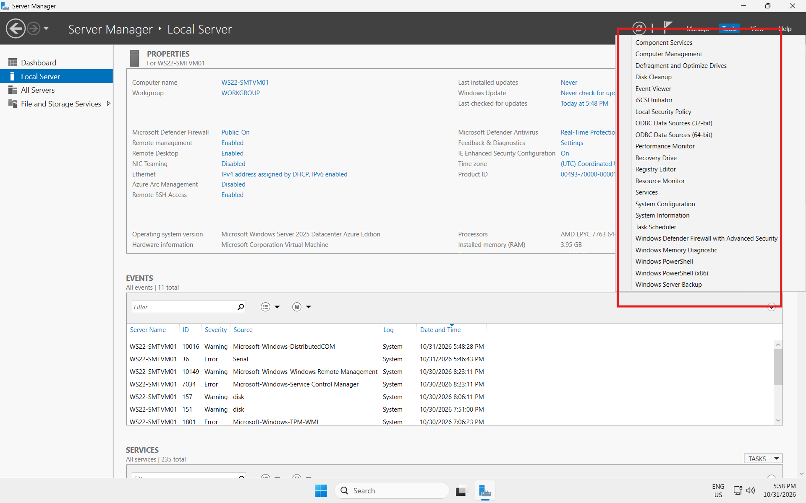

---

## 2. Launch Add Roles and Features

From **Server Manager**, the **Add Roles and Features** wizard was launched.

This wizard allows additional Windows Server roles and management components to be installed.

### Screenshot:
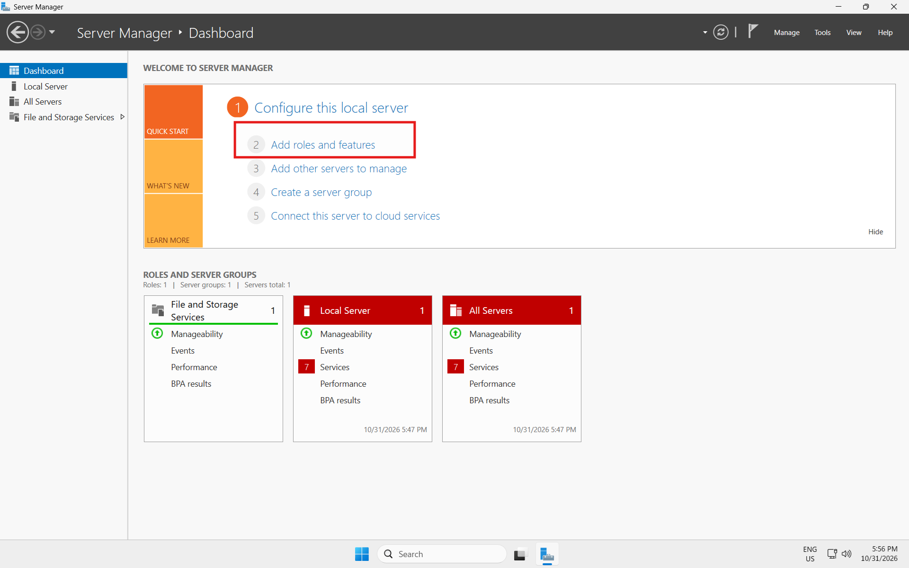

---

## 3. Select Active Directory Domain Services

Under **Server Roles**, the following role was selected:

```text
Active Directory Domain Services
```

AD DS provides the directory infrastructure required to centrally manage:

- Users
- Computers
- Groups
- Authentication
- Organizational Units
- Group Policy

### Screenshot:
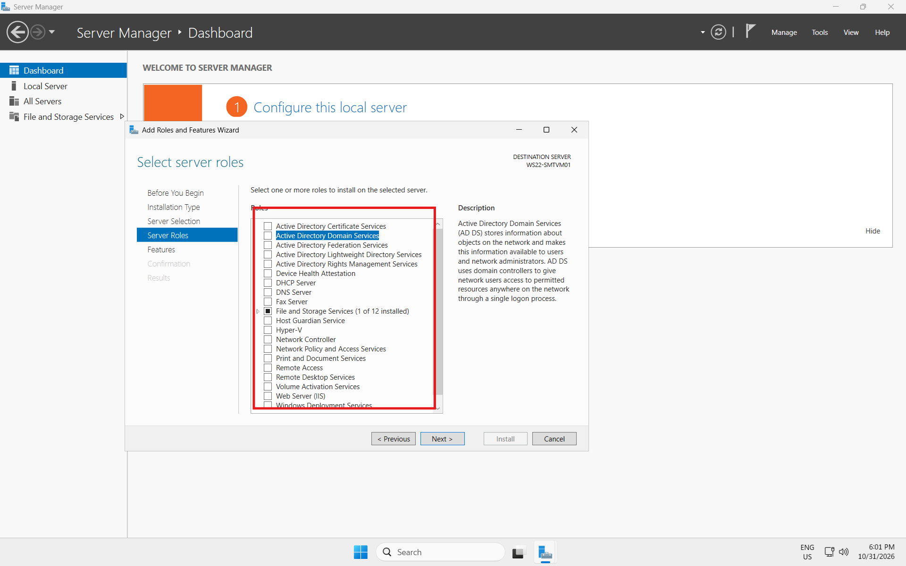

---

## 4. Install Active Directory Management Tools

Windows Server identified additional management components required for AD DS administration.

These included:

- Group Policy Management
- Remote Server Administration Tools
- AD DS and AD LDS Tools
- Active Directory Administrative Center
- Active Directory PowerShell Module
- AD DS Snap-Ins and Command-Line Tools

These tools provide both graphical and command-line administration capabilities.

### Screenshot:
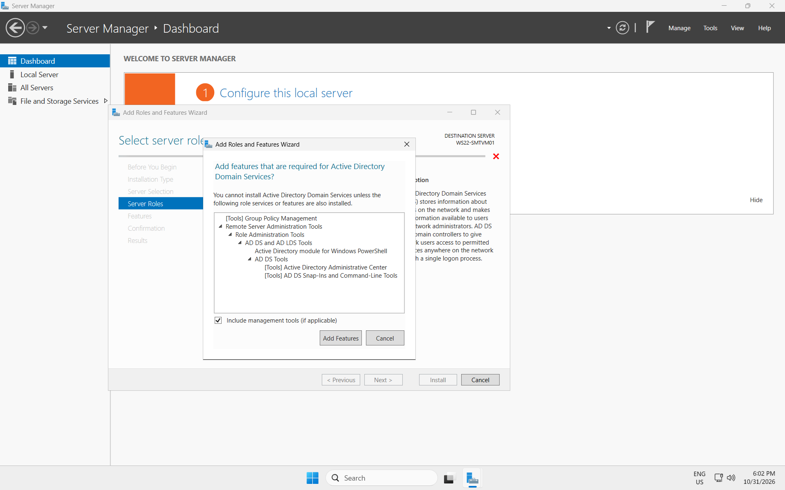

---

## 5. Confirm Required Features

The required Windows Server features were reviewed before installation.

**Group Policy Management** was included, preparing the environment for later domain security configurations such as:

- Password policies
- Account lockout policies
- User restrictions
- Computer restrictions
- Security baselines
- Centralized Windows configuration

### Screenshot:
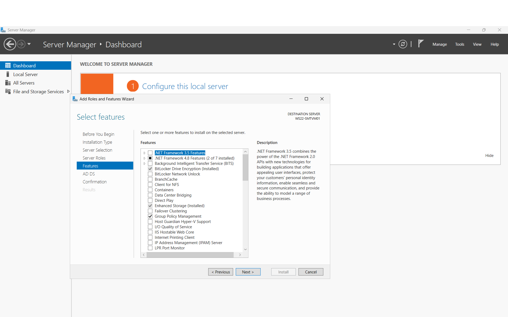

---

## 6. Review Active Directory Domain Services

The AD DS information screen was reviewed before proceeding.

Active Directory provides a centralized directory that allows administrators to securely manage identities, computers, authentication, and access to domain resources.

### Screenshot:
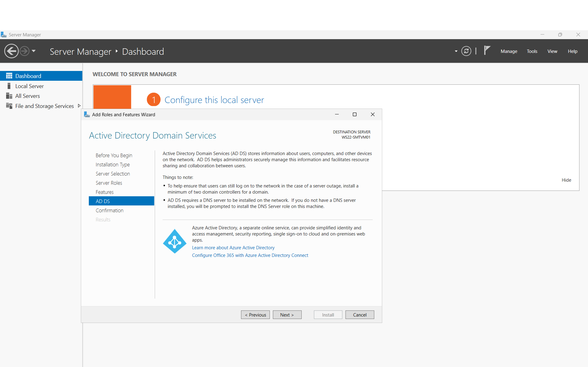

---

## 7. Confirm Installation

The selected AD DS role and supporting administration components were reviewed before deployment.

The configuration included:

```text
Active Directory Domain Services
│
├── Group Policy Management
│
└── Remote Server Administration Tools
    │
    └── Role Administration Tools
        │
        └── AD DS and AD LDS Tools
            │
            ├── Active Directory Administrative Center
            └── AD DS Snap-Ins and Command-Line Tools
```

Automatic server restart was permitted if required.

### Screenshot:
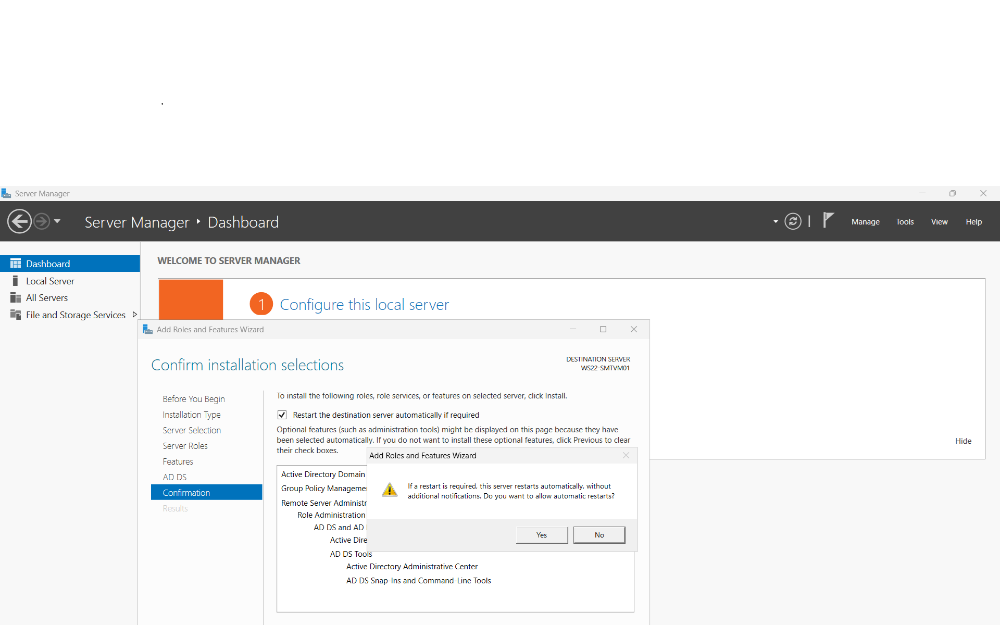

---

## 8. Complete AD DS Role Installation

The AD DS role installation completed successfully on:

```text
WS22-SMTVM01
```

Windows Server reported:

> **Configuration required. Installation succeeded.**

Installing AD DS adds the required components, but the server must still be **promoted to a Domain Controller** before it can provide domain services.

### Screenshot:
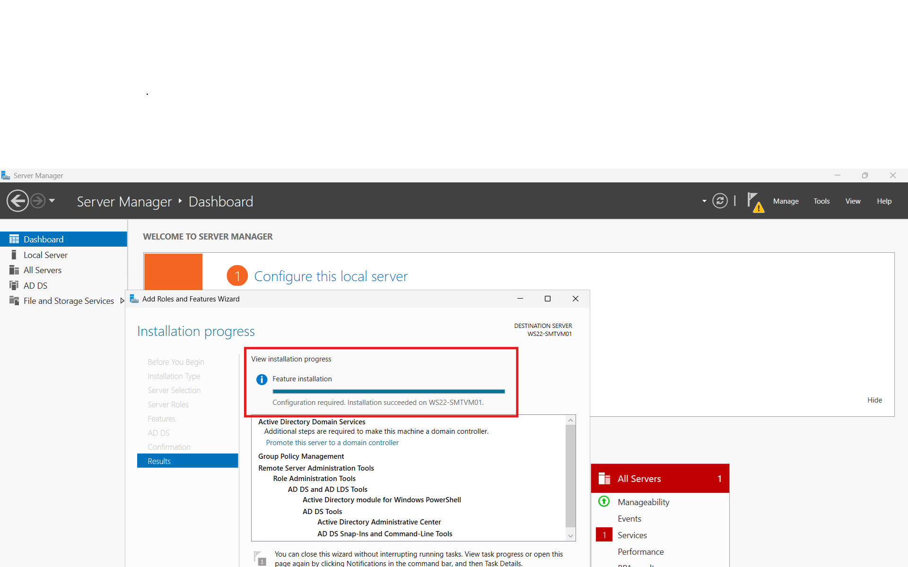

---

# Domain Controller Deployment

## 9. Begin Domain Controller Promotion

Following AD DS installation, Server Manager identified a required post-deployment task:

```text
Promote this server to a domain controller
```

Promotion converts the Windows Server from a system containing the AD DS role into an operational **Domain Controller**.

### Screenshot:
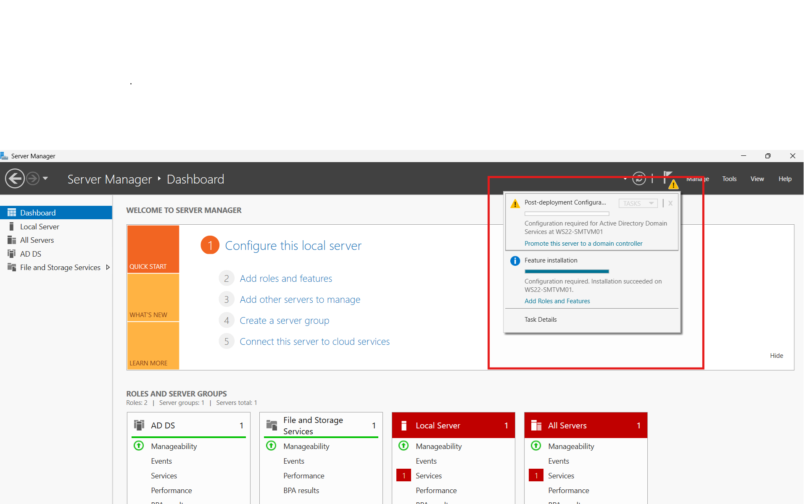

---

## 10. Create a New Active Directory Forest

Because the lab environment was being created from scratch, the deployment option selected was:

```text
Add a new forest
```

The root domain was configured as:

```text
shaunmonwabisiteka.com
```

The forest establishes the top-level Active Directory structure within which domains, users, computers, groups, Organizational Units, and Group Policies can be managed.

### Screenshot:
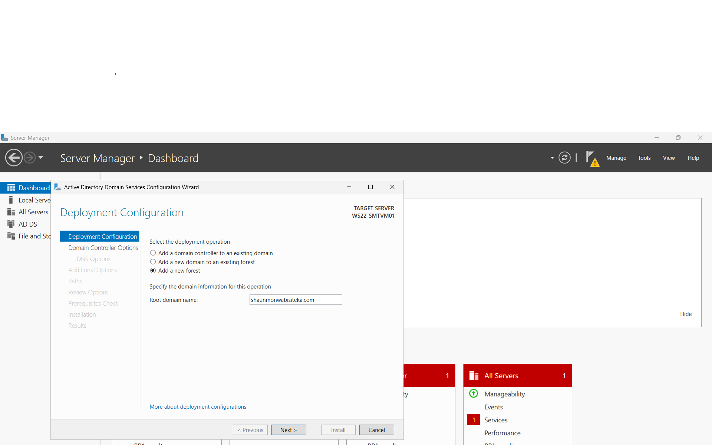

---

# Networking and DNS

## 11. Review the Server Network Adapter

The server's network connection was reviewed through:

```text
Network Connections
      ↓
Ethernet
      ↓
Properties
```

Network configuration is especially important for Domain Controllers because Active Directory relies heavily on **DNS and reliable IP connectivity**.

### Screenshot:
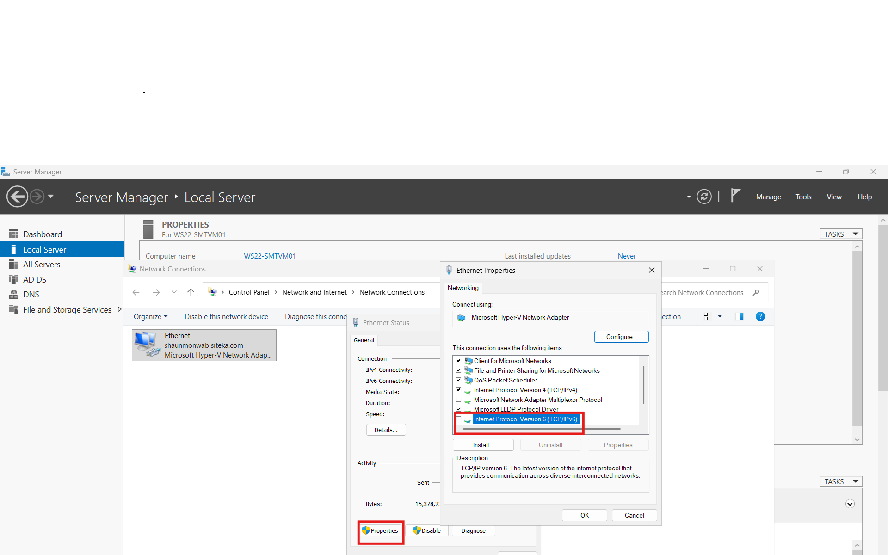

> ⚠️ **Lab Observation:** The environment later reported that the IPv4 address was being assigned dynamically. For a production Domain Controller hosted in Azure, predictable private IP addressing should be maintained through the Azure Network Interface configuration.

---

# Domain Controller Configuration

## 12. Configure Domain Controller Options

The first Domain Controller was configured with:

```text
Forest Functional Level: Windows Server 2025
Domain Functional Level: Windows Server 2025

DNS Server:       Enabled
Global Catalog:   Enabled
RODC:             Disabled
```

A **Directory Services Restore Mode (DSRM)** password was also configured.

### Why this matters

**DNS Server**

DNS allows domain clients and servers to locate Active Directory services.

**Global Catalog**

The Global Catalog maintains searchable directory information and assists with locating directory objects.

**DSRM**

Directory Services Restore Mode provides a recovery mechanism for Active Directory maintenance and disaster recovery scenarios.

### Security Note

Passwords, DSRM credentials, administrator credentials, recovery secrets, and similar sensitive information should **never be committed to a public GitHub repository**.

### Screenshot:
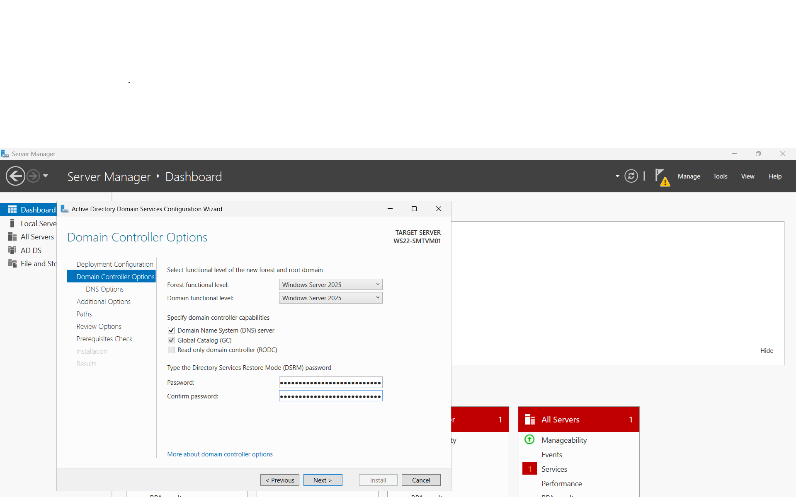

---

## 13. Review DNS Options

The AD DS wizard displayed a warning indicating that DNS delegation could not automatically be created because an authoritative parent zone could not be found.

For this standalone lab forest, DNS delegation was not created during the deployment.

The Domain Controller itself was configured with the DNS Server role.

### Screenshot:
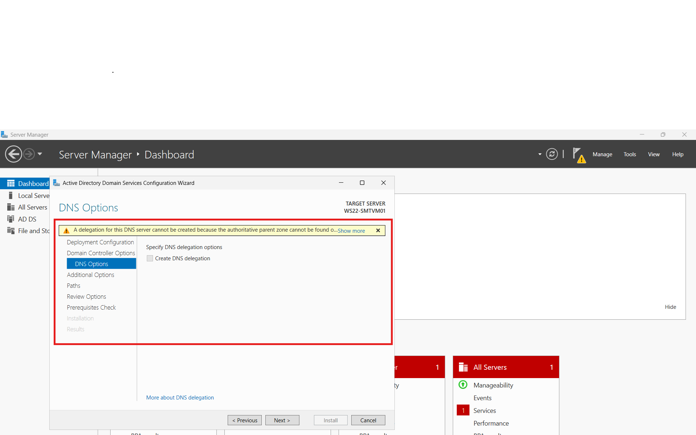

> 💡 The warning did not prevent the deployment. The later prerequisites validation confirmed that the required checks passed successfully.

---

# Active Directory Naming

## 14. Configure the NetBIOS Domain Name

The configuration wizard generated the following NetBIOS domain name:

```text
SHAUNMONWABISIT
```

The NetBIOS name provides a shortened representation of the domain for Windows operations and compatibility scenarios.

### Screenshot:
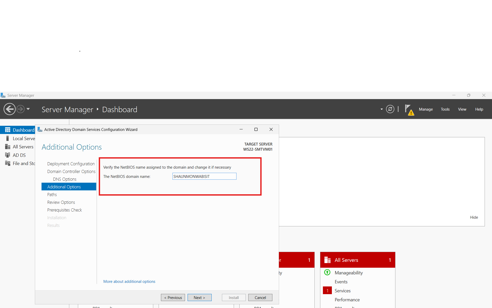

---

# Active Directory Database

## 15. Review AD DS Storage Paths

The default locations were retained for the Active Directory database, log files, and SYSVOL directory.

```text
Database:
C:\Windows\NTDS

Log Files:
C:\Windows\NTDS

SYSVOL:
C:\Windows\SYSVOL
```

### What these directories contain

**NTDS**

Stores the Active Directory database and associated information.

**SYSVOL**

Stores domain-wide files required by Active Directory, including Group Policy-related content.

### Screenshot:


---

# Configuration Review

## 16. Review the Final Deployment Configuration

Before installation, the complete Domain Controller configuration was reviewed.

The configuration confirmed:

```text
Server:
WS22-SMTVM01

Deployment:
First Domain Controller in a new forest

Domain:
shaunmonwabisiteka.com

NetBIOS:
SHAUNMONWABISIT

Forest Functional Level:
Windows Server 2025

Domain Functional Level:
Windows Server 2025

Global Catalog:
Yes

DNS Server:
Yes

DNS Delegation:
No
```

Reviewing the configuration before deployment helps prevent incorrect forest, domain, DNS, and functional-level configurations.

### Screenshot:
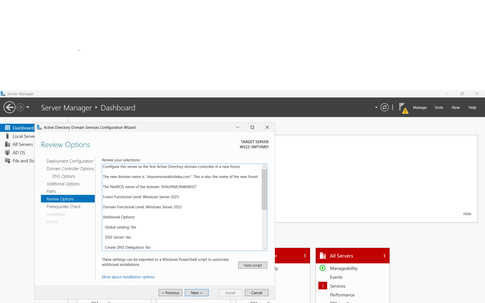

---

# Prerequisites Validation

## 17. Run AD DS Prerequisites Check

Before Domain Controller promotion, Windows Server performed the required prerequisite checks.

The wizard reported:

> **All prerequisite checks passed successfully.**

The server was therefore ready for installation and Domain Controller promotion.

The wizard also indicated that the system would automatically restart after completing the promotion.

### Screenshot:
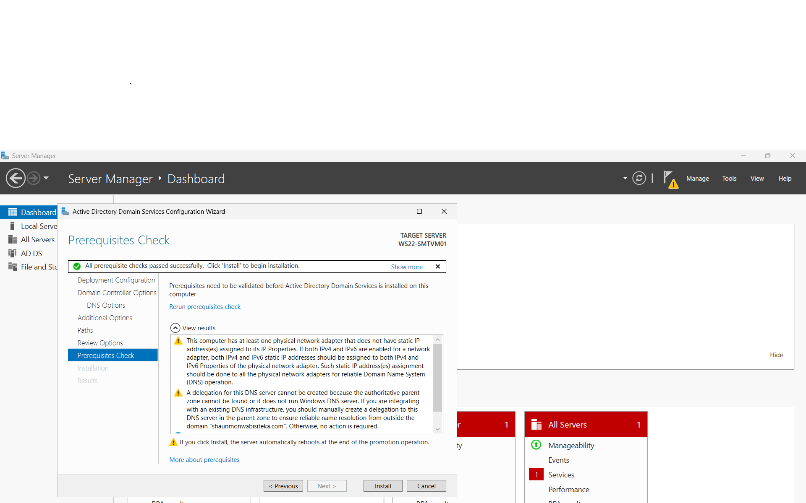

### Infrastructure Observation

The prerequisites screen also identified the network interface configuration as an area requiring attention.

Stable IP addressing is important for Domain Controllers because domain members need consistent access to **DNS and Active Directory services**.

In an Azure environment, stable private IP allocation should therefore be considered part of the production-hardening process.

---

# Post-Deployment Verification

## 18. Verify Active Directory Administrative Tools

Following promotion and restart, the Active Directory administrative tools became available from **Server Manager → Tools**.

Available consoles included:

```text
Active Directory Administrative Center
Active Directory Domains and Trusts
Active Directory Module for Windows PowerShell
Active Directory Sites and Services
Active Directory Users and Computers
ADSI Edit
DNS
Group Policy Management
```

This verified that the required administrative components were available for managing the new environment.

### Screenshot:
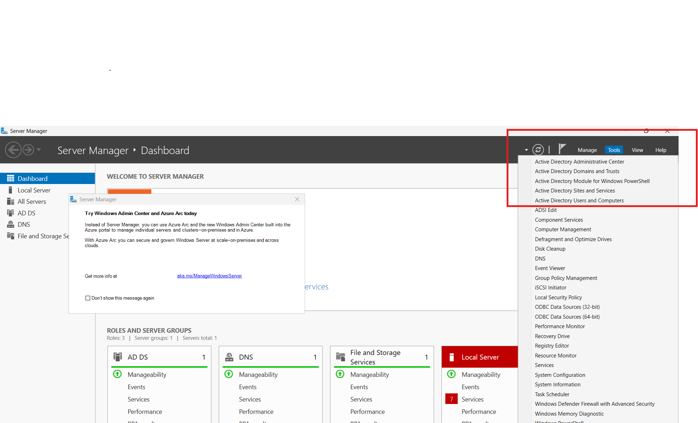

---

## 19. Verify the Domain Configuration

Server Manager was used to verify the completed server configuration.

The server displayed:

```text
Computer Name:
WS22-SMTVM01

Domain:
shaunmonwabisiteka.com
```

Server Manager also displayed the following installed roles:

```text
AD DS
DNS
```

This provides post-deployment evidence that the server is operating within the newly established Active Directory environment.

### Screenshot:
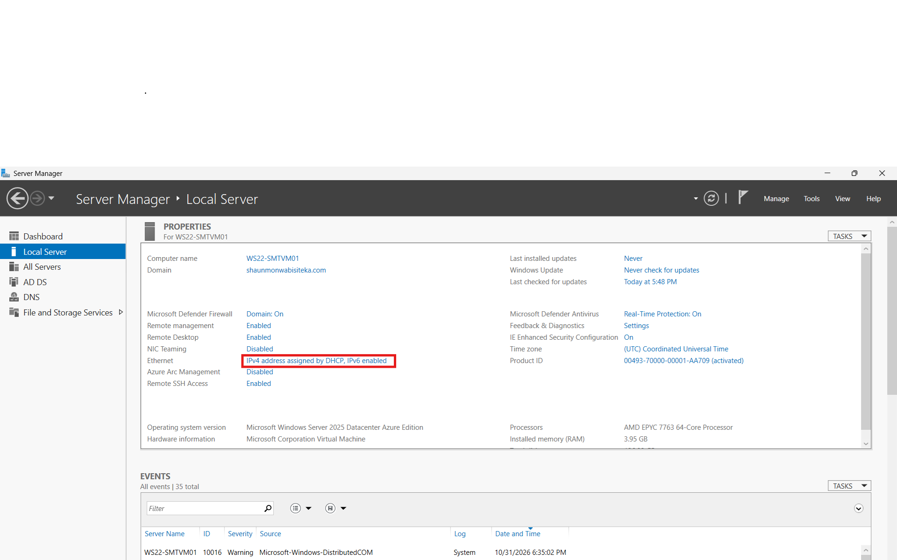


---

## 20. Verify the Domain Network

The Windows network connection was also associated with:

```text
shaunmonwabisiteka.com
```

Together with Server Manager, AD DS, DNS, and the available administrative tools, this provides additional validation of the completed domain environment.

### Screenshot:
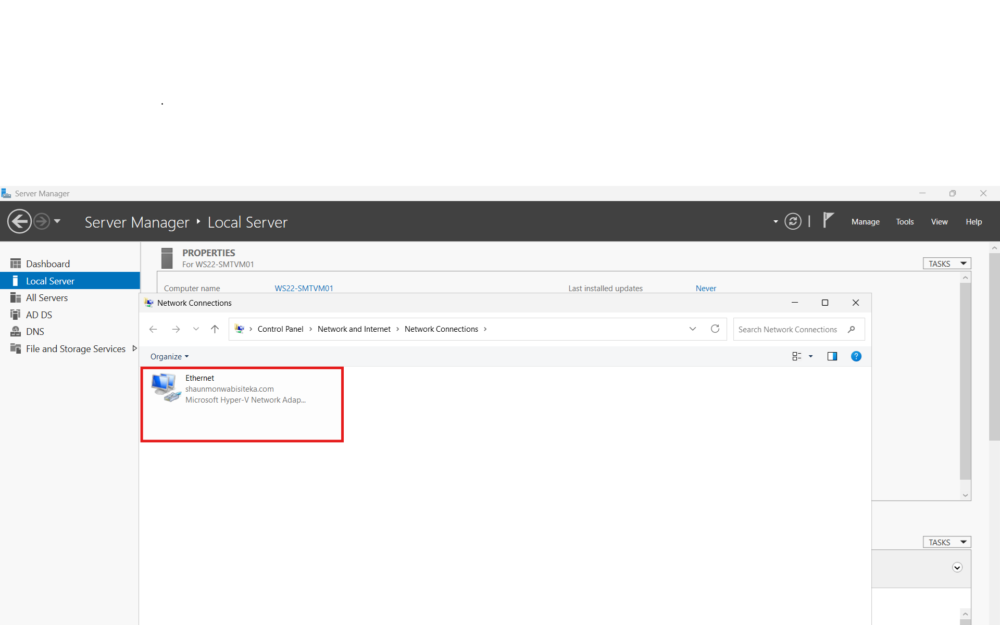

---

# Final Result

The Windows Server VM was successfully transformed from a standalone server into the foundation of a centralized **Active Directory domain environment**.

### Deployment completed

- [x] Active Directory Domain Services installed
- [x] Active Directory management tools installed
- [x] New Active Directory forest established
- [x] Root domain created
- [x] Domain Controller configured
- [x] DNS Server enabled
- [x] Global Catalog enabled
- [x] DSRM configured
- [x] NetBIOS domain name established
- [x] AD DS database and SYSVOL locations configured
- [x] Prerequisite checks passed
- [x] Active Directory administration tools verified
- [x] Domain configuration verified
- [x] Network domain association verified

---

> This project forms part of my hands-on cloud infrastructure and cybersecurity portfolio, demonstrating practical experience with Microsoft Azure, Windows Server, Active Directory, networking, identity management, and enterprise security administration.
