# Windows Client Domain Join

## Project Overview

This section demonstrates how the **SMT-CLIENT01 Windows 11 Pro virtual machine** was successfully joined to an Active Directory domain hosted in Microsoft Azure.

The implementation covers the complete domain-join workflow:

- Azure client VM preparation
- Virtual network and subnet validation
- DNS configuration
- Domain name resolution
- Domain controller discovery
- Domain authentication
- Client restart
- Domain membership verification
- Active Directory computer-object verification

This process transformed the standalone Windows 11 virtual machine into a centrally managed Active Directory domain member.

---

## Objective

The objective was to integrate the Windows 11 client into the Active Directory environment so that the computer could be centrally managed using:

- Active Directory Domain Services
- Domain-based user authentication
- Group Policy
- Centralized security policies
- Organizational Units
- Active Directory computer objects
- Administrative access controls

---

## Technologies and Tools

| Technology | Purpose |
|---|---|
| Microsoft Azure | Hosting the virtual infrastructure |
| Azure Virtual Machines | Hosting the Windows client and domain controller |
| Azure Virtual Network | Private network communication |
| Azure Network Interface | Connecting the client VM to the virtual network |
| Network Security Group | Controlling permitted network traffic |
| Windows Server | Hosting Active Directory and DNS services |
| Active Directory Domain Services | Providing centralized identity management |
| Active Directory-integrated DNS | Resolving the domain and locating the domain controller |
| Windows 11 Pro | Client operating system |
| PowerShell | Validating networking, DNS, and domain discovery |
| Active Directory Users and Computers | Verifying the registered computer object |

---

## Environment Summary

| Component | Configuration |
|---|---|
| Client computer | `SMT-CLIENT01` |
| Client operating system | Windows 11 Pro |
| Client private IP address | `172.16.0.5` |
| Domain controller | `WS25-SMTVM01` |
| Domain controller IP address | `172.16.0.4` |
| DNS server | `172.16.0.4` |
| Default gateway | `172.16.0.1` |
| Active Directory domain | `shaunmonwabisiteka.com` |
| Client FQDN after domain join | `SMT-CLIENT01.shaunmonwabisiteka.com` |

> [!NOTE]
> Private IP addresses are included to demonstrate the internal lab architecture. Public IP addresses and sensitive information have been hidden.

---

## Domain Join Workflow

```text
SMT-CLIENT01
      │
      │ Azure Virtual Network
      ▼
Client Network Interface
      │
      │ DNS Server: 172.16.0.4
      ▼
Active Directory DNS
      │
      ▼
Domain Name Resolution
      │
      ▼
Domain Controller Discovery
      │
      ▼
Domain Authentication
      │
      ▼
Join Active Directory Domain
      │
      ▼
Restart Client Computer
      │
      ▼
Verify Client Domain Membership
      │
      ▼
Verify Computer Object in Active Directory
```

---

# Implementation

## 1. Deploy and Verify the Client Virtual Machine

The domain-join process began with the **SMT-CLIENT01** virtual machine running Windows 11 Pro in Microsoft Azure.

The Azure VM overview was reviewed to confirm that:

- The virtual machine was running.
- Windows 11 Pro was installed.
- The VM was connected to the required virtual network and subnet.
- The network interface was attached.
- The Azure VM agent was ready.

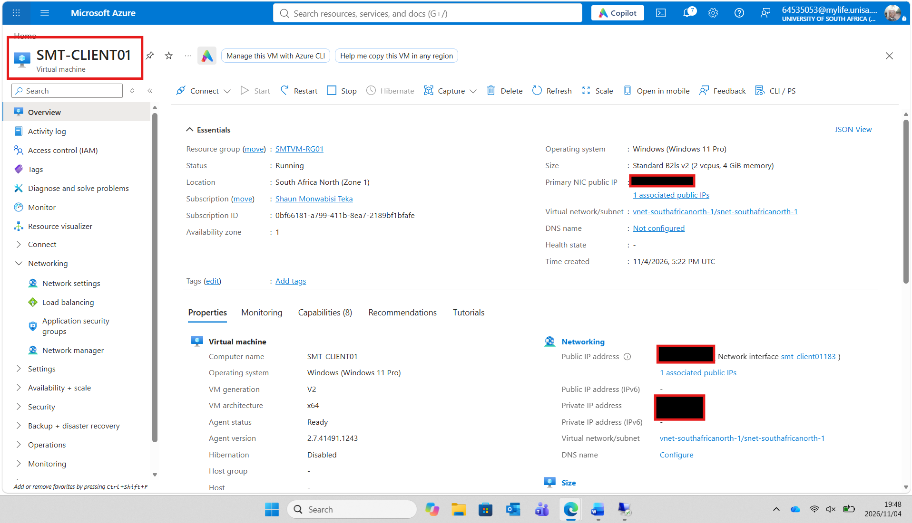

**Result:** The Windows 11 client VM was running and ready for network and domain configuration.

---

## 2. Verify the Azure Network Configuration

The **Network settings** page was reviewed to verify the client VM's network interface and security configuration.

The configuration confirmed that:

- The client network interface was active.
- The VM was connected to the Azure virtual network.
- The required subnet was assigned.
- A Network Security Group was associated with the network interface.
- Remote Desktop connectivity was available for administration.

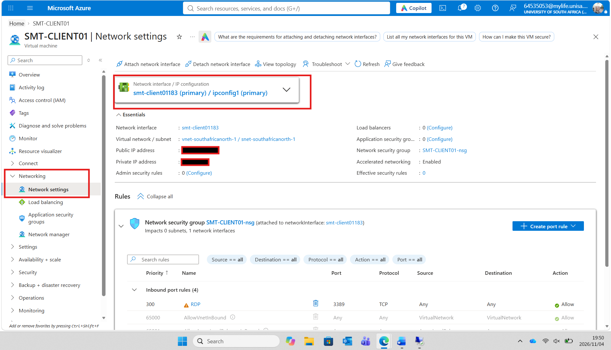

Proper network connectivity is required because the client must communicate with the domain controller for DNS, authentication, LDAP, Kerberos, and Group Policy services.

**Result:** The client VM was correctly connected to the Azure network.

---

## 3. Verify the Client IP Configuration

The Azure network interface IP configuration was reviewed to confirm the client VM's private addressing and subnet placement.

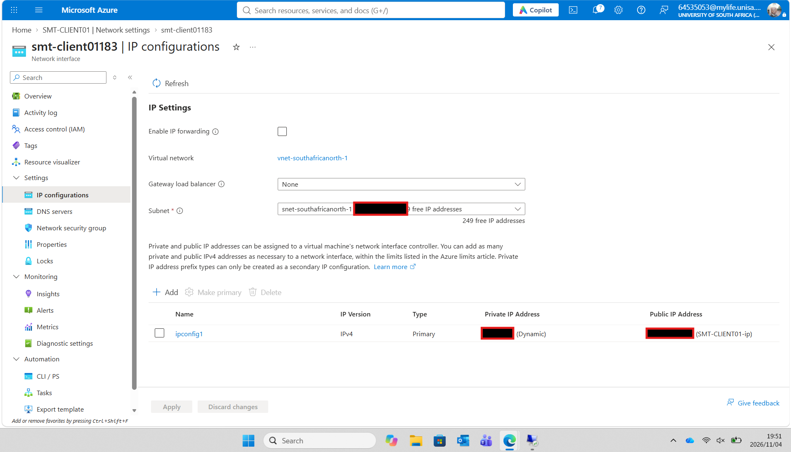

The client and domain controller were placed within the Azure private network so that domain-related communication could occur through private IP connectivity.

**Result:** The client network interface had a valid private IP configuration.

---

## 4. Validate the Client's DNS Configuration

Active Directory depends heavily on DNS. The client must use the DNS server hosting the Active Directory domain records.

The following PowerShell command was executed on **SMT-CLIENT01**:

```powershell
ipconfig /all
```

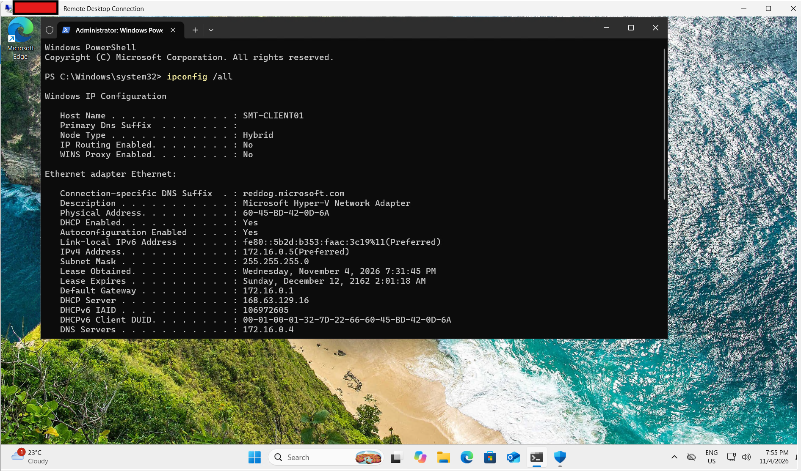

The command output confirmed the following important settings:

```text
Host Name       : SMT-CLIENT01
IPv4 Address    : 172.16.0.5
Subnet Mask     : 255.255.255.0
Default Gateway : 172.16.0.1
DNS Server      : 172.16.0.4
```

The DNS server address points to the domain controller at `172.16.0.4`.

This ensures that domain-related DNS requests are sent to the Active Directory DNS server instead of an external DNS provider.

**Result:** The client was configured to use the Active Directory DNS server.

---

## 5. Test Domain Name Resolution

The Active Directory domain name was tested using `nslookup`.

```powershell
nslookup shaunmonwabisiteka.com
```

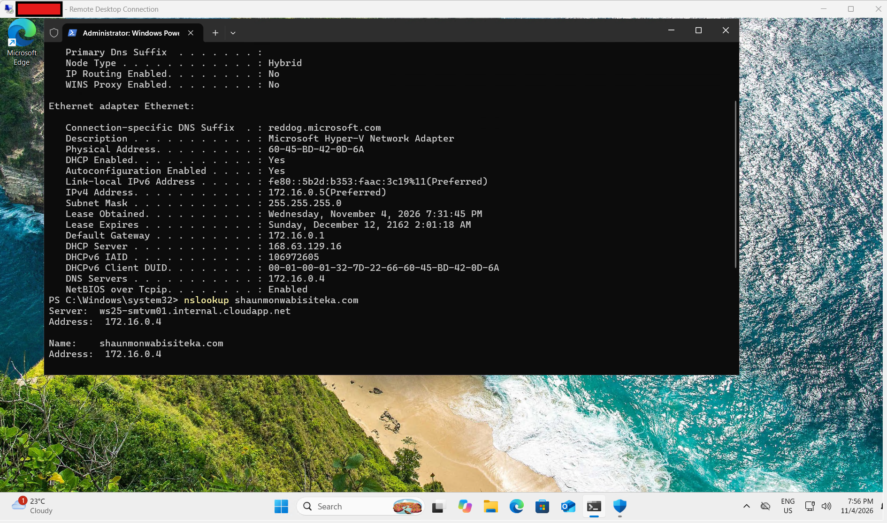

The lookup successfully returned:

```text
Name:    shaunmonwabisiteka.com
Address: 172.16.0.4
```

This confirmed that:

- The client could communicate with the DNS server.
- The Active Directory domain name could be resolved.
- The domain resolved to the domain controller's private IP address.

> [!IMPORTANT]
> A successful DNS lookup is a key prerequisite for joining a Windows computer to an Active Directory domain. Incorrect DNS configuration is one of the most common causes of domain-join failures.

**Result:** The Active Directory domain resolved successfully.

---

## 6. Discover the Domain Controller

Domain controller discovery was tested before attempting the domain join.

The following command was executed:

```powershell
nltest /dsgetdc:shaunmonwabisiteka.com
```

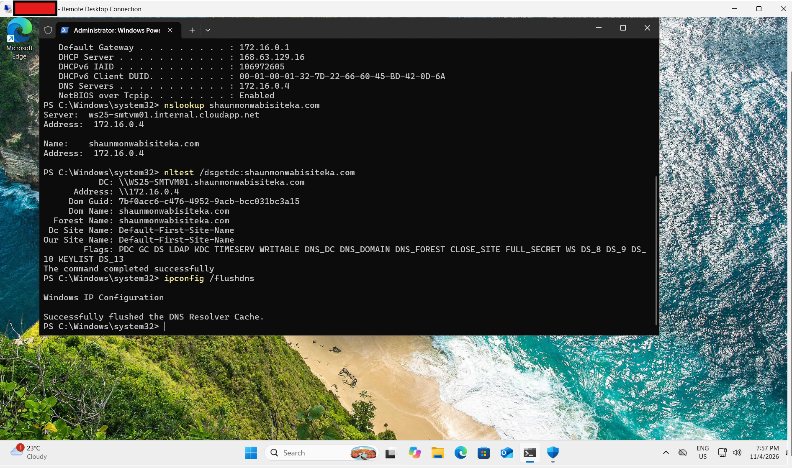

The command returned the following information:

```text
Domain Controller : \\WS25-SMTVM01.shaunmonwabisiteka.com
Address           : \\172.16.0.4
Domain Name       : shaunmonwabisiteka.com
Forest Name       : shaunmonwabisiteka.com
```

The output ended with:

```text
The command completed successfully
```

The test verified that the Windows client could locate an available domain controller for the domain.

The DNS resolver cache was also cleared using:

```powershell
ipconfig /flushdns
```

Clearing the DNS cache ensures that the client does not continue using outdated DNS information after configuration changes.

**Result:** The client successfully discovered the domain controller.

---

## 7. Enter the Active Directory Domain

The Windows computer membership settings were opened from:

```text
Settings
└── System
    └── About
        └── Domain or workgroup
            └── Change
```

The **Domain** option was selected, and the Active Directory domain name was entered:

```text
shaunmonwabisiteka.com
```

Authorized domain credentials were then supplied to approve the domain-join request.

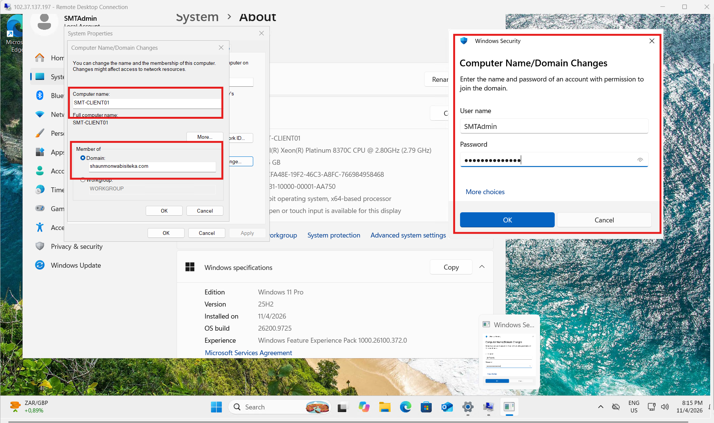

The authentication step confirms that the account being used has permission to add the computer to the domain.

> [!CAUTION]
> Passwords, credentials, access tokens, public IP addresses, subscription identifiers, and other sensitive information must be hidden before screenshots are uploaded to a public GitHub repository.

**Result:** Authorized credentials were submitted for the domain join.

---

## 8. Confirm the Successful Domain Join

After the credentials were accepted, Windows displayed the following confirmation message:

```text
Welcome to the shaunmonwabisiteka.com domain.
```

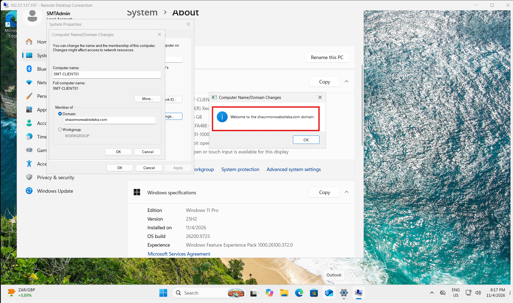

This message provides direct evidence that the domain controller accepted the client as a member of the Active Directory domain.

**Result:** `SMT-CLIENT01` successfully joined the domain.

---

## 9. Confirm the Restart Requirement

Windows indicated that the client computer needed to be restarted to complete the domain membership process.

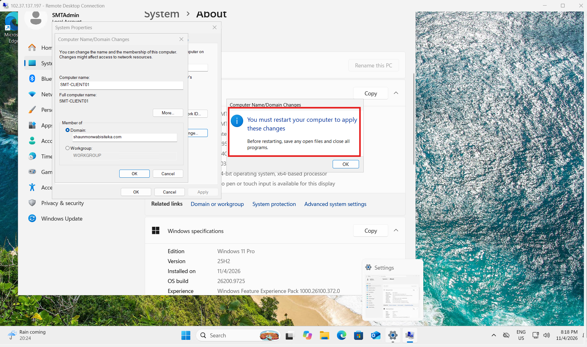

A restart is required because Windows must initialize the new computer-domain trust relationship and load the updated domain membership configuration.

**Result:** Windows confirmed that a restart was required.

---

## 10. Restart the Client Computer

The **Restart Now** option was selected to apply the domain membership changes.

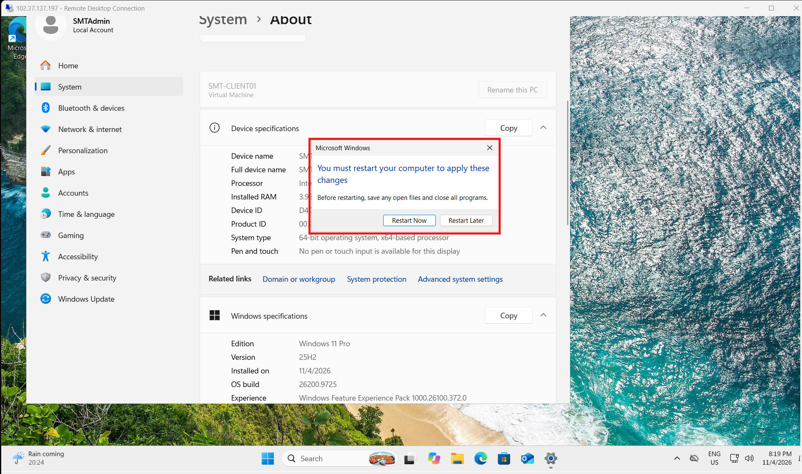

After restarting, the computer transitioned from a standalone workgroup computer into an Active Directory domain member.

**Result:** The client restarted to complete the domain join.

---

# Post-Join Verification

## 11. Verify Domain Membership on the Client

After the restart, domain membership was verified from the Windows 11 client.

The verification was completed from:

```text
Settings
└── System
    └── About
        └── Device specifications
```

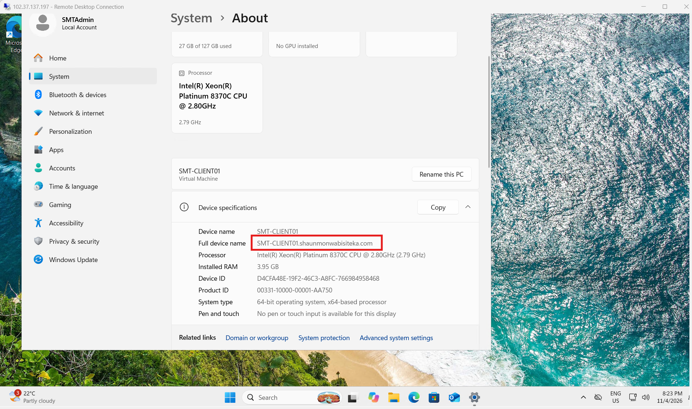

The system displayed the following full device name:

```text
SMT-CLIENT01.shaunmonwabisiteka.com
```

The fully qualified domain name confirms that the Windows client is associated with the Active Directory DNS namespace.

**Result:** Domain membership was successfully verified from the Windows client.

---

## 12. Verify the Computer Object in Active Directory

The final verification was completed on the domain controller using **Active Directory Users and Computers**.

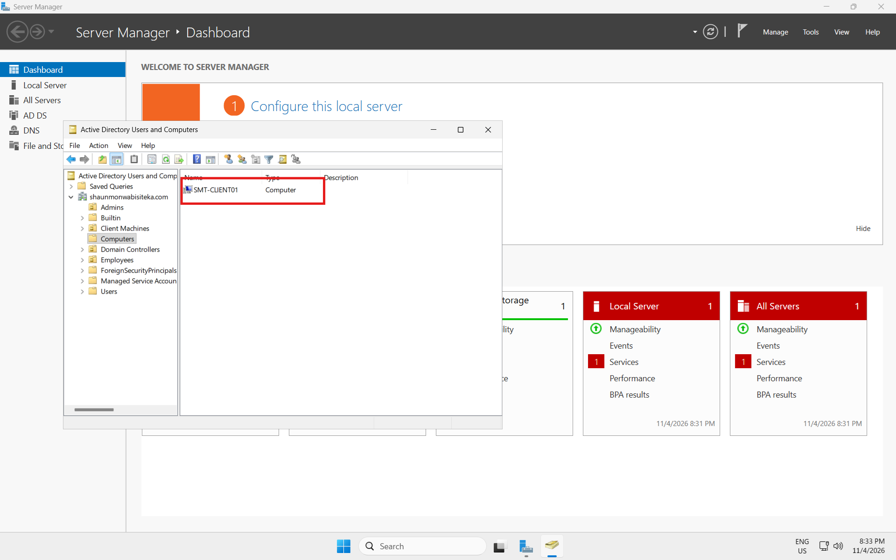

An Active Directory computer object named the following was visible:

```text
SMT-CLIENT01
```

The computer object provides server-side confirmation that the client was successfully registered in Active Directory.

The computer object can now be moved into an appropriate Organizational Unit for targeted Group Policy management.

**Result:** The client computer object was successfully registered in Active Directory.

---

# Validation Summary

| Validation Check | Result |
|---|---|
| Windows 11 client VM deployed | ✅ Passed |
| Azure VM running successfully | ✅ Passed |
| Network interface connected | ✅ Passed |
| Virtual network and subnet verified | ✅ Passed |
| Client private IP address verified | ✅ Passed |
| DNS configured to `172.16.0.4` | ✅ Passed |
| Domain name resolved successfully | ✅ Passed |
| Domain controller discovered | ✅ Passed |
| Domain authentication completed | ✅ Passed |
| Client accepted into the domain | ✅ Passed |
| Client restarted successfully | ✅ Passed |
| Client FQDN verified | ✅ Passed |
| Active Directory computer object verified | ✅ Passed |

---

# PowerShell Commands Used

## Display the Complete Network Configuration

```powershell
ipconfig /all
```

This command displays the computer's IP address, subnet mask, default gateway, DNS server, DHCP information, and network adapter configuration.

---

## Test Active Directory DNS Resolution

```powershell
nslookup shaunmonwabisiteka.com
```

This command confirms whether the client can resolve the Active Directory domain through the configured DNS server.

---

## Discover the Domain Controller

```powershell
nltest /dsgetdc:shaunmonwabisiteka.com
```

This command searches for an available domain controller and returns domain, forest, site, IP address, and supported service information.

---

## Clear the DNS Resolver Cache

```powershell
ipconfig /flushdns
```

This command removes cached DNS records so that the client can request current DNS information.

---

## Optional Post-Join Validation Commands

The following commands can also be used after the restart:

```powershell
# Display the computer's Active Directory domain
systeminfo | findstr /B /C:"Domain"

# Display the user and domain context
whoami

# Display detailed computer and domain information
Get-ComputerInfo | Select-Object CsName, CsDomain, CsDomainRole

# Test the secure channel between the client and domain
Test-ComputerSecureChannel -Verbose

# Display the domain controller used by the client
nltest /dsgetdc:shaunmonwabisiteka.com

# Apply and verify Group Policy
gpupdate /force
gpresult /r
```

---

# Key Technical Takeaways

This implementation demonstrates that joining a Windows computer to Active Directory is not a single isolated action.

A successful domain join depends on the following sequence:

```text
Network Connectivity
        ↓
Correct DNS Configuration
        ↓
Domain Name Resolution
        ↓
Domain Controller Discovery
        ↓
Authorized Authentication
        ↓
Computer-Domain Trust Relationship
        ↓
Client Restart
        ↓
Active Directory Registration
```

The most important technical dependency is DNS.

The client must use the DNS server that hosts the Active Directory domain records. If the client uses an incorrect DNS server, the client may have internet access but still fail to locate the Active Directory domain controller.

---

# Security Considerations

The following security practices were followed or should be applied to this environment:

- Public IP addresses were hidden from screenshots.
- Domain passwords were not exposed.
- Domain join credentials should only be used by authorized administrators.
- Remote Desktop access should not be open to unrestricted internet sources.
- Network Security Group rules should restrict RDP to a trusted source IP address.
- Azure Bastion or a secure VPN should be considered instead of direct public RDP access.
- The client should be moved into a dedicated Organizational Unit after joining the domain.
- Group Policy should be used to apply workstation security controls.
- Administrative accounts should not be used for normal daily activities.
- Sensitive Azure subscription xt
172.16.0.4
```

Restart the client or renew the network configuration before testing again.

---

## Domain Does Not Resolve

### Test

```powershell
nslookup shaunmonwabisiteka.com
```

### Resolution

Confirm that:

- The DNS service is running on the domain controller.
- The correct DNS zone exists.
- The client is using `172.16.0.4` as the DNS server.
- The client can communicate with the domain controller.

---

## Domain Controller Cannot Be Discovered

### Test

```powershell
nltest /dsgetdc:shaunmonwabisiteka.com
```

### Resolution

Verify:

- Domain Controller availability
- DNS records
- Azure virtual network connectivity
- Network Security Group rules
- Windows Firewall configuration
- Active Directory Domain Services health

---

## Authentication Fails

Confirm that:

- The domain account has permission to join computers.
- The correct domain credentials are being used.
- The account is not locked.
- The domain controller is reachable.
- The domain name has been entered correctly.

---

## Domain Membership Does Not Appear After Joining

Restart the client computer and verify the full device name from:

```text
Settings → System → About
```

The expected name is:

```text
SMT-CLIENT01.shaunmonwabisiteka.com
```

---

# Skills Demonstrated

This implementation demonstrates practical experience with:

- Microsoft Azure infrastructure
- Azure Virtual Machines
- Azure virtual networking
- Azure network interfaces
- Azure subnets
- Network Security Groups
- Windows Server administration
- Windows 11 administration
- Active Directory Domain Services
- Active Directory-integrated DNS
- PowerShell troubleshooting
- DNS configuration and validation
- Domain controller discovery
- Windows domain membership
- Active Directory Users and Computers
- Client-server identity integration
- Computer object management
- Infrastructure documentation
- Technical evidence collection

---

#  Final Outcome

The **SMT-CLIENT01** Windows 11 virtual machine was successfully integrated into the `shaunmonwabisiteka.com` Active Directory environment.

The implementation confirmed:

- Correct Azure private network connectivity
- Correct Active Directory DNS configuration
- Successful domain name resolution
- Successful domain controller discovery
- Authorized domain authentication
- Successful client domain membership
- Successful client restart and configuration
- Successful computer-object registration in Active Directory

The completed configuration provides a foundation for centralized user authentication, Group Policy enforcement, workstation security management, and enterprise identity administration.

---
