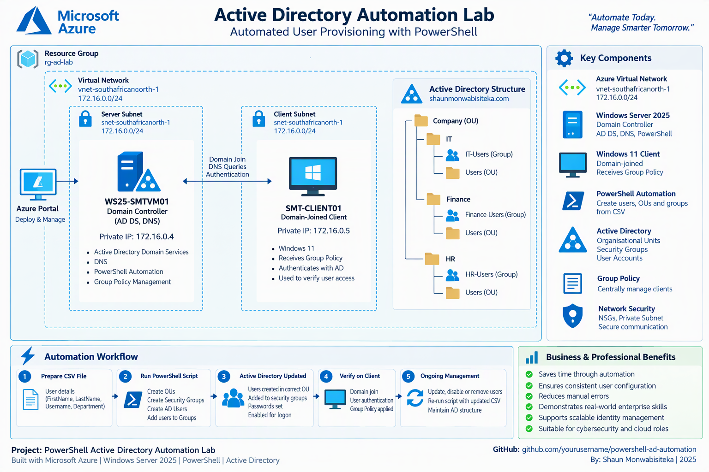
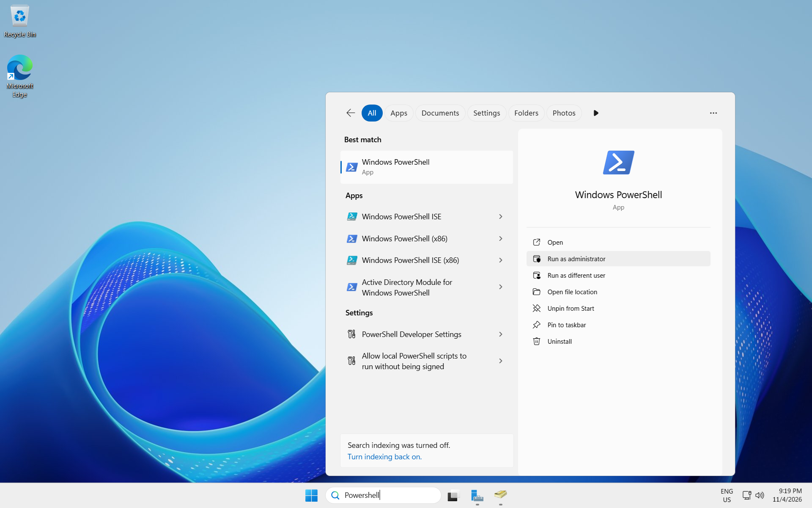
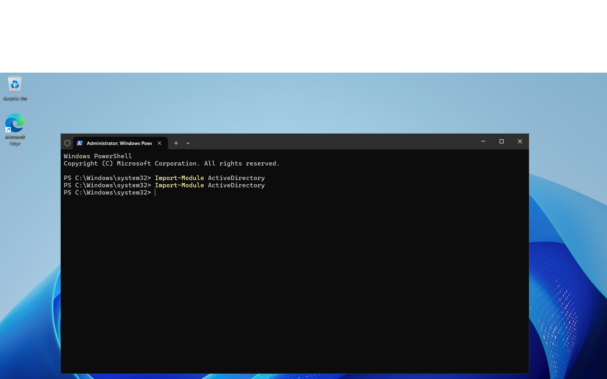
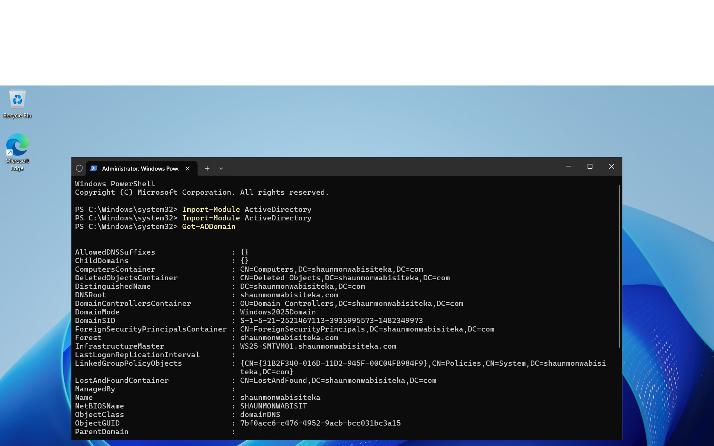
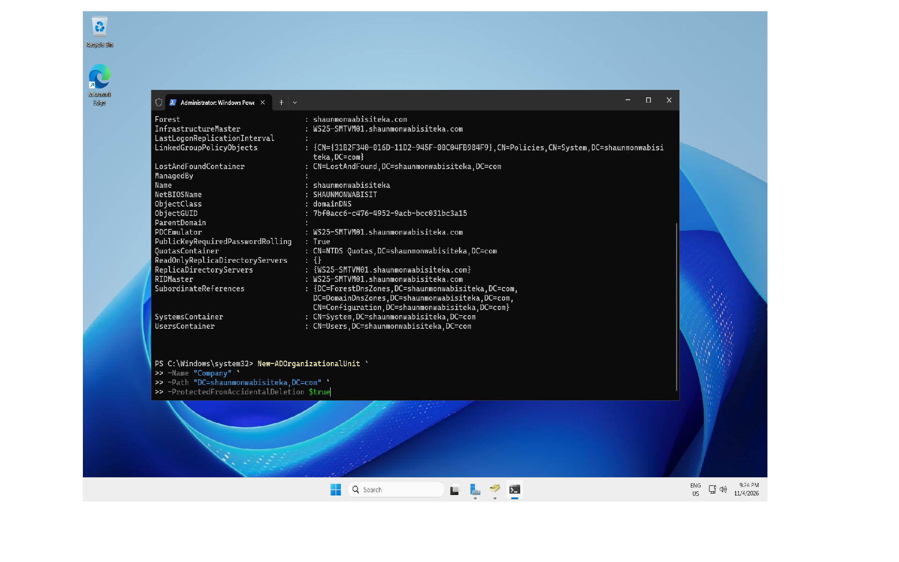
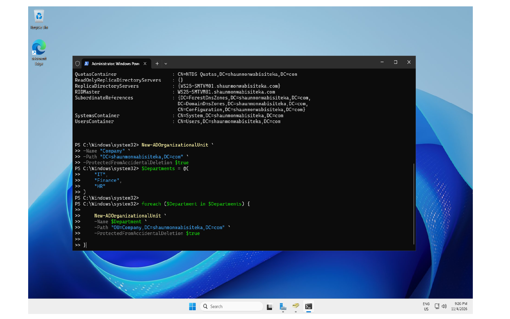
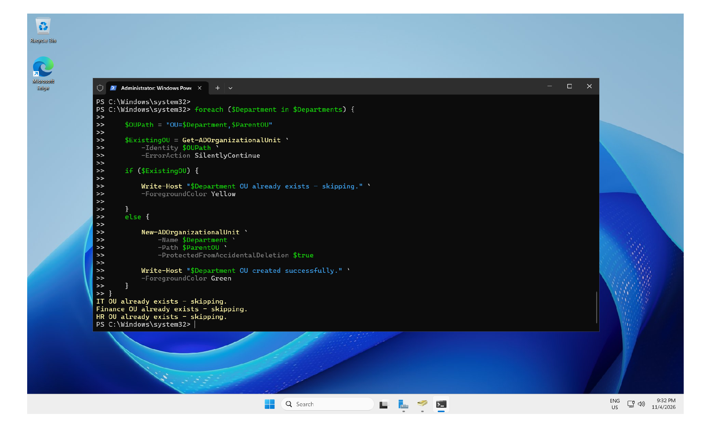
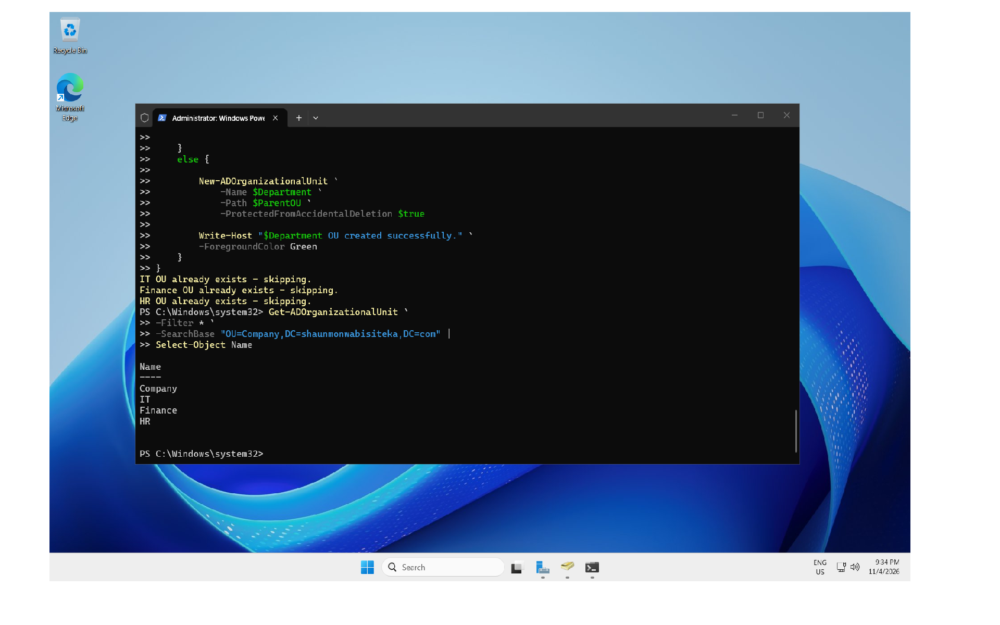
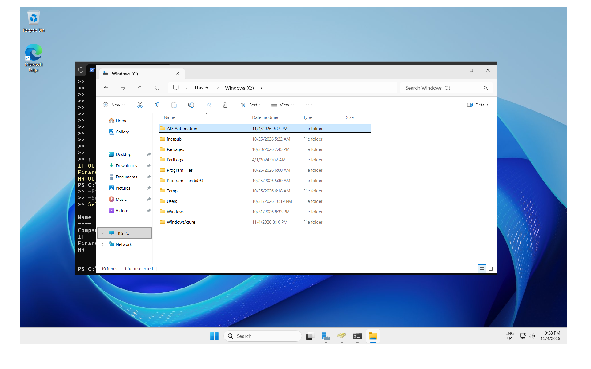
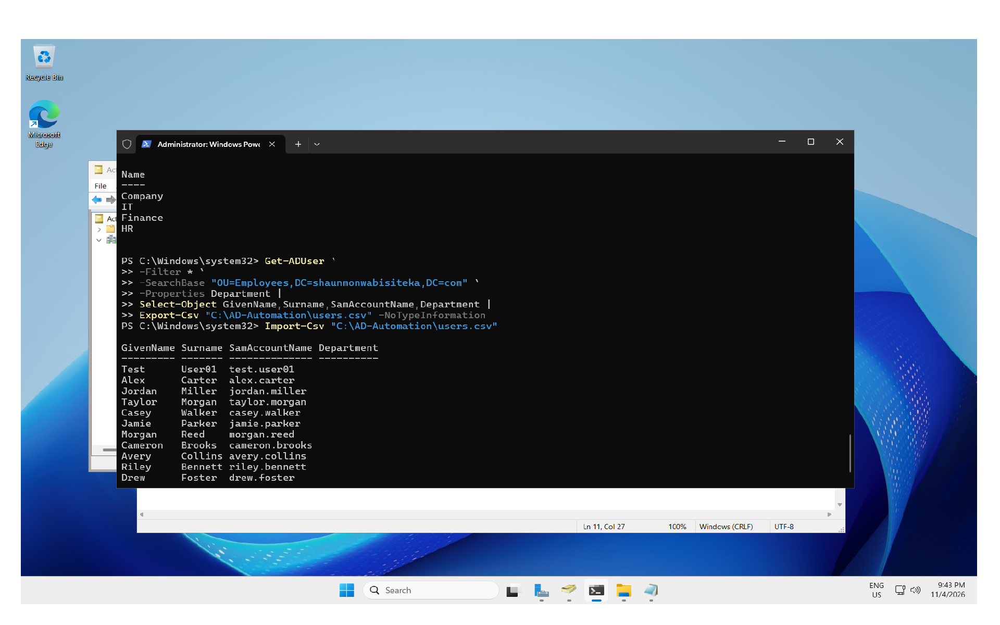

# PowerShell Active Directory Automation Lab


## Project Overview

This project demonstrates how **PowerShell can automate Microsoft Active Directory administration** within an Azure-hosted Windows Server environment.

The lab focuses on replacing repetitive manual tasks with reusable automation for creating organisational structures, validating directory objects, managing user information, and generating CSV-based reports.

---

## Project Objectives

- Automate repetitive Active Directory administration
- Create and manage Organisational Units (OUs)
- Build department structures using PowerShell loops
- Prevent duplicate objects through validation checks
- Query Active Directory users and objects
- Export directory information to CSV
- Demonstrate repeatable identity-management workflows

---

## Architecture



The environment consists of:

- **Microsoft Azure** for cloud infrastructure
- **Windows Server 2025** as the Domain Controller
- **Active Directory Domain Services (AD DS)** for identity management
- **PowerShell** for automation
- **Windows 11** as the domain-joined client
- **CSV files** for structured user data and reporting

---

## Automation Workflow

```text
User / CSV Data
       ↓
PowerShell Automation
       ↓
Active Directory
       ↓
Organisational Units
       ↓
Users & Groups
       ↓
Validation
       ↓
CSV Reporting
```

This workflow demonstrates how manual Active Directory administration can be converted into a **repeatable and scalable automation process**.

---

## 1. Load the Active Directory Module

The Active Directory PowerShell module was loaded to enable AD administration through PowerShell.

```powershell
Import-Module ActiveDirectory
```

The domain configuration was then verified using:

```powershell
Get-ADDomain
```

---

## 2. Automate Organisational Unit Creation

A parent OU was created as the foundation for the organisational structure.

```powershell
New-ADOrganizationalUnit `
    -Name "Company" `
    -Path "DC=example,DC=com" `
    -ProtectedFromAccidentalDeletion $true
```

Department OUs were then created automatically.

```powershell
$Departments = @(
    "IT",
    "Finance",
    "HR"
)

foreach ($Department in $Departments) {

    New-ADOrganizationalUnit `
        -Name $Department `
        -Path "OU=Company,DC=example,DC=com" `
        -ProtectedFromAccidentalDeletion $true
}
```

This removes the need to manually create each department individually.

---

## 3. Prevent Duplicate Objects

The automation was improved by checking whether each OU already existed before creating it.

```powershell
$ExistingOU = Get-ADOrganizationalUnit `
    -Identity $OUPath `
    -ErrorAction SilentlyContinue

if ($ExistingOU) {

    Write-Host "$Department OU already exists - skipping."

}
else {

    New-ADOrganizationalUnit `
        -Name $Department `
        -Path $ParentOU `
        -ProtectedFromAccidentalDeletion $true

    Write-Host "$Department OU created successfully."
}
```

### Why this matters

The script becomes safer to run multiple times because existing objects are skipped instead of recreated.

This introduces the principle of **idempotent automation**.

---

## 4. Validate the AD Structure

The completed OU structure was verified using PowerShell.

```powershell
Get-ADOrganizationalUnit `
    -Filter * `
    -SearchBase "OU=Company,DC=example,DC=com" |
Select-Object Name
```

The validation confirmed that the required organisational structure had been successfully created.

Example:

```text
Company
IT
Finance
HR
```

---

## 5. Export Active Directory Users

Active Directory user information was queried and exported to CSV.

```powershell
Get-ADUser `
    -Filter * `
    -SearchBase "OU=Employees,DC=example,DC=com" `
    -Properties Department |
Select-Object GivenName,Surname,SamAccountName,Department |
Export-Csv "C:\AD-Automation\users.csv" -NoTypeInformation
```

The CSV can support:

- User auditing
- Account reviews
- Administrative reporting
- Data validation
- Bulk administration
- Future automation workflows

---

## 6. Validate Exported Data

The exported CSV was imported back into PowerShell to confirm that the data had been captured successfully.

```powershell
Import-Csv "C:\AD-Automation\users.csv"
```

This provides a simple validation step before exported data is used by another process.

---

## Screenshot:

### PowerShell Administrative Environment

PowerShell was executed with administrative privileges to perform Active Directory management tasks.



### Active Directory Module

The Active Directory PowerShell module was successfully imported.



### Domain Validation

`Get-ADDomain` was used to validate connectivity and retrieve information about the Active Directory domain.



### OU Automation

PowerShell was used to create the parent Company OU and departmental OUs.





### Duplicate Protection

The script checks for existing OUs before attempting creation, allowing the automation to be safely re-run.



### Structure Validation

The resulting Active Directory organisational structure was queried and validated.



### User Export

Active Directory users were queried and exported into CSV format.



### CSV Validation

The exported CSV was imported back into PowerShell to verify the resulting dataset.



---

## Skills Demonstrated

| Area | Skills |
|---|---|
| **Automation** | PowerShell scripting, loops, conditional logic |
| **Identity** | Active Directory, users, OUs and groups |
| **Administration** | Windows Server 2025, AD DS |
| **Data** | CSV import/export and structured datasets |
| **Cloud** | Microsoft Azure infrastructure |
| **Reliability** | Validation, duplicate detection and error handling |
| **Security** | Protected OUs and controlled identity administration |

---

## Business Value

PowerShell automation reduces dependency on repetitive manual administration and creates a more:

**Consistent → Repeatable → Scalable → Auditable**

identity-management process.

The solution demonstrates how automation can reduce:

- Manual administrative effort
- Configuration inconsistencies
- Repetitive tasks
- Duplicate-object errors
- Human error

---

## Future Improvements

The project can be extended with:

- Automated AD user provisioning from CSV
- Automatic security-group assignment
- User onboarding and offboarding
- Account disablement workflows
- Automated password generation
- Logging and error reporting
- `-WhatIf` / dry-run functionality
- PowerShell functions and reusable modules
- Scheduled automation
- Microsoft Entra ID integration
- Microsoft Graph PowerShell

---

## Key Takeaway

> **Automation is not simply about replacing manual commands. It is about building repeatable, controlled and scalable administrative processes.**

This project demonstrates the transition from **manual Active Directory administration to structured PowerShell automation**.

---

Hands-on portfolio project demonstrating practical experience with Microsoft Azure, Windows Server, Active Directory and PowerShell.
