# 🖥️ Azure Virtual Machine Deployment Lab

A hands-on Microsoft Azure project demonstrating how I deployed, accessed, managed, stopped, and removed a Windows Server 2025 Virtual Machine using the Azure Portal.

---

## 📌 Project Overview

This project documents my practical experience creating and managing a **Windows Server 2025 Virtual Machine** in Microsoft Azure.

The deployment was completed through the **Azure Portal**, which provides a browser-based interface for creating virtual machines and their supporting resources.

During this lab, I:

- Signed in to the Azure Portal
- Created a new Resource Group
- Configured a Windows Server 2025 Virtual Machine
- Selected the Trusted Launch security type
- Configured Remote Desktop access
- Deployed the Virtual Machine
- Connected to the server through RDP
- Accessed Windows Server Manager
- Stopped and deallocated the Virtual Machine
- Reviewed the process for deleting the Resource Group

---

## 🎯 Project Objectives

The objectives of this Azure lab were to:

- Gain hands-on experience using the Azure Portal
- Create and manage an Azure Resource Group
- Deploy a Windows Server Virtual Machine
- Understand Azure VM images and sizes
- Configure administrator credentials
- Configure Remote Desktop access
- Understand Network Security Group rules
- Connect to an Azure VM using RDP
- Access Windows Server Manager
- Stop and deallocate an Azure VM
- Understand how to remove Azure resources when they are no longer required

---

## 🧰 Azure Services and Technologies

`Microsoft Azure`

`Azure Virtual Machines`

`Azure Resource Groups`

`Windows Server 2025 Datacenter: Azure Edition`

`Azure Virtual Network`

`Network Security Group`

`Remote Desktop Protocol`

`Public IP Address`

`Managed Disks`

`Trusted Launch`

---

## 🏗️ Lab Configuration

| Configuration | Selection |
|---|---|
| Resource Group | `SMTVM-RG01` |
| Azure Region | `(Africa) South Africa North` |
| Availability Option | `No infrastructure redundancy required` |
| Security Type | `Trusted launch virtual machines` |
| Operating System | `Windows Server 2025 Datacenter: Azure Edition` |
| VM Generation | `Generation 2` |
| VM Size | `Standard_B2als_v2` |
| Virtual CPUs | `2 vCPUs` |
| Memory | `4 GiB` |
| Remote Access | `RDP` |
| RDP Port | `TCP 3389` |

> **Note:** The Azure Portal displayed an estimated cost of `$42.34/month` at the time the VM size was selected. Azure prices can vary according to region, usage, operating system, licensing, currency, and changes to Microsoft pricing.

---

# ⚙️ Implementation and Demonstration

## 1. Sign in to the Azure Portal

I started the lab by signing in to my Microsoft Azure account.

The Azure home page displayed the Azure services and resources available under my subscription. From this page, I could access the services required to create and manage the Virtual Machine.

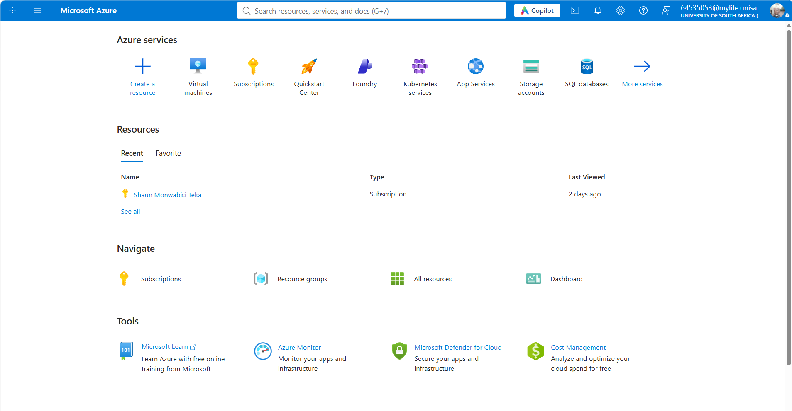

> **Figure 1:** Azure Portal home page after signing in to the Azure account.

---

## 2. Open Azure Virtual Machines

From the Azure Portal, I selected **Virtual machines**, which was displayed as the first available option.

The Virtual Machines service is used to create, configure, monitor, start, stop, and manage virtual machines hosted in Microsoft Azure.

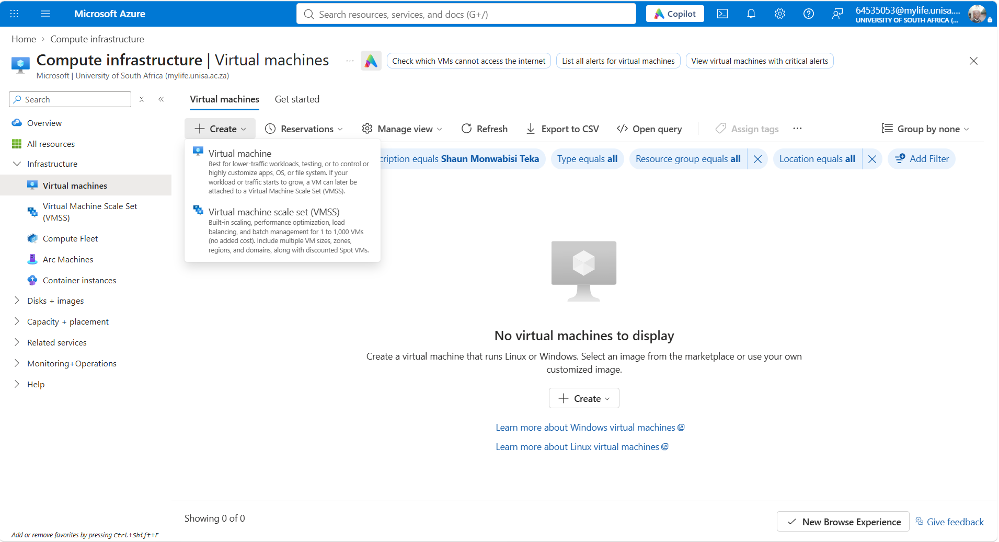

> **Figure 2:** Selecting the Virtual Machines service from the Azure Portal.

---

## 3. Configure the Basic VM Settings

I began creating a new Virtual Machine through the Azure Portal.

This method provides a browser-based user interface for configuring a VM and its associated Azure resources.

For the initial configuration, I selected the following settings:

- **Resource Group:** `SMTVM-RG01`
- **Region:** `(Africa) South Africa North`
- **Availability Option:** `No infrastructure redundancy required`
- **Security Type:** `Trusted launch virtual machines`

Azure displayed three security-type options:

1. Standard
2. Trusted launch virtual machines
3. Confidential virtual machines

For this project, I selected **Trusted launch virtual machines**.

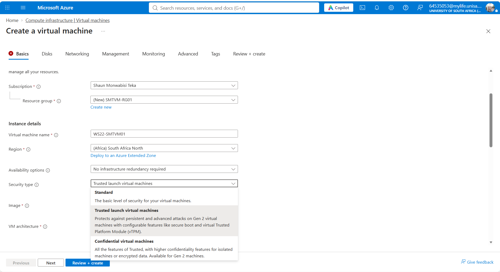

> **Figure 3:** Configuring the Resource Group, region, availability option, and VM security type.

---

## 4. Browse the Available VM Images

Next, I selected **See all images**.

This opened the image selection page, where Azure provides available public and private images that can be used to create Virtual Machines.

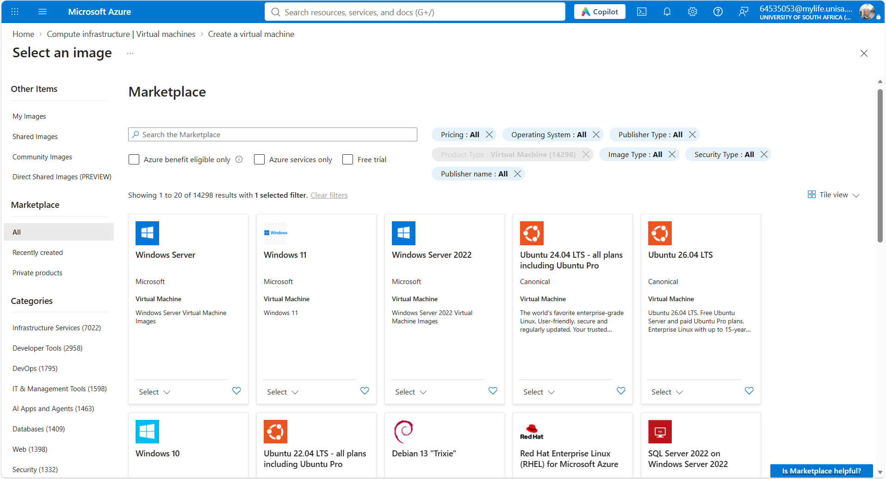

> **Figure 4:** Selecting “See all images” to browse the available VM operating-system images.

---

## 5. Select Windows Server 2025

From the available images, I selected:

**Windows Server 2025 Datacenter: Azure Edition**

This image uses a **Generation 2** Virtual Machine configuration.

I then selected the following VM size:

- **Size:** `Standard_B2als_v2`
- **Processors:** `2 vCPUs`
- **Memory:** `4 GiB`
- **Displayed estimated cost:** `$42.34/month`

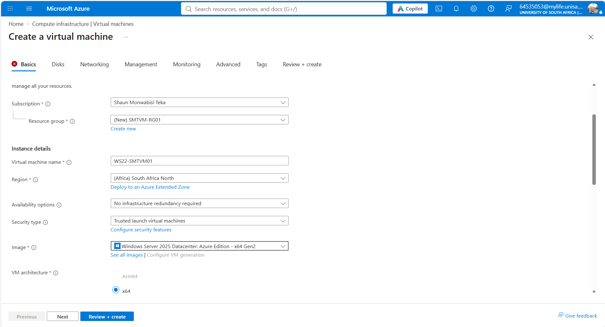

> **Figure 5:** Selecting the Windows Server 2025 Datacenter: Azure Edition image and the Standard_B2als_v2 VM size.

---

## 6. Configure Administrator Access and Inbound Ports

I configured the administrator account credentials that would be used to access the Windows Virtual Machine.

I also reviewed the inbound port rules required for remote access.

For this Windows-based VM, I enabled:

- **Remote access protocol:** `RDP`
- **Protocol:** `TCP`
- **Port:** `3389`

The inbound rule is managed through a **Network Security Group**, which controls permitted inbound and outbound network traffic.

After reviewing the settings, I selected **Review + create** to validate the configuration before deployment.

> ⚠️ Exposing RDP port `3389` to the public internet increases the VM's attack surface. For a production environment, access should be restricted to an approved source IP address or provided through a more secure administrative access method.

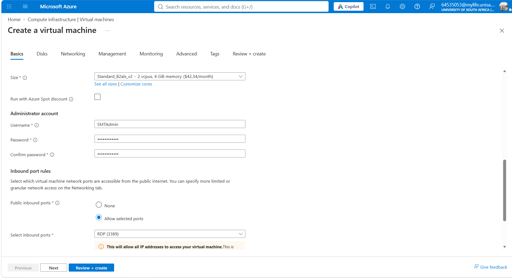

> **Figure 6:** Configuring administrator credentials and enabling RDP access on TCP port 3389.

---

## 7. Validate the VM Configuration

Azure performed a validation of the selected VM configuration.

The validation process completed successfully, confirming that the required settings had been provided and that the configuration was ready for deployment.

I reviewed the selected configuration before proceeding with the creation of the Virtual Machine.

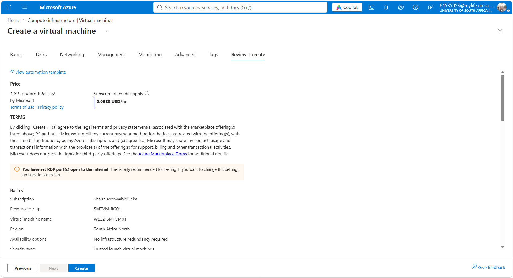

> **Figure 7:** Successful validation on the Review + create page.

---

## 8. Deploy the Virtual Machine

After reviewing the configuration, I selected **Create** to begin deploying the Windows Virtual Machine.

During the deployment process, Azure created the VM and its related network resources.

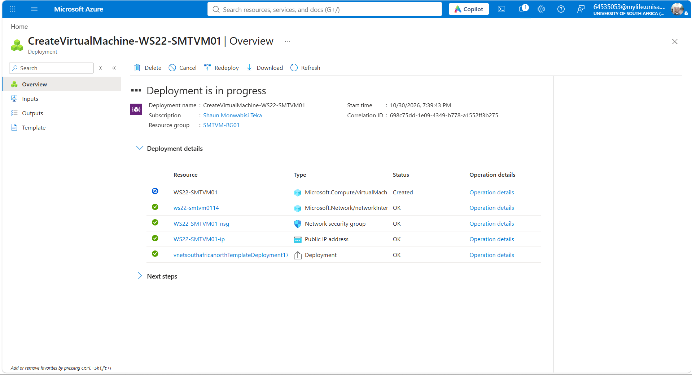

> **Figure 8:** Azure VM deployment in progress, with network-related resources being created.

---

## 9. Confirm Successful Deployment

The deployment completed successfully.

After Azure confirmed that the deployment was complete, I selected **Go to resource** to open the dashboard for the newly created Virtual Machine.

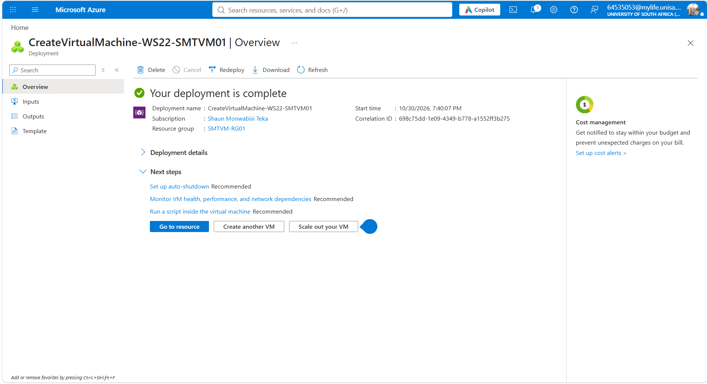

> **Figure 9:** Confirmation that the Azure Virtual Machine was deployed successfully.

---

# 🔌 Connecting to the Virtual Machine

## 10. Open the VM Overview Page

The **Overview** page displayed the operational details of the new Virtual Machine.

From this page, I reviewed the VM status and located the public IP address required for the Remote Desktop connection.

I copied the public IP address so that I could connect to the Windows Server remotely.

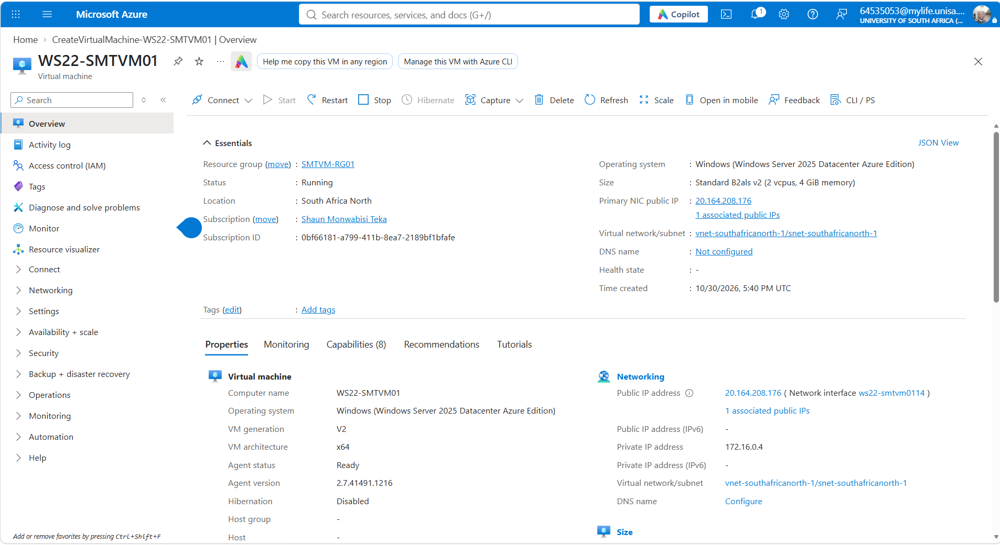

> **Figure 10:** Azure VM Overview page showing the deployed Virtual Machine and its network information.

> 🔒 **Security notice:** Blur or hide the public IP address before publishing this image in a public GitHub repository.

---

## 11. Open the Run Dialog

On my local computer, I opened the Windows **Run** dialog.

I entered the following command:

```text
mstsc
```

I then pressed **Enter** to launch the Microsoft Remote Desktop Connection client.

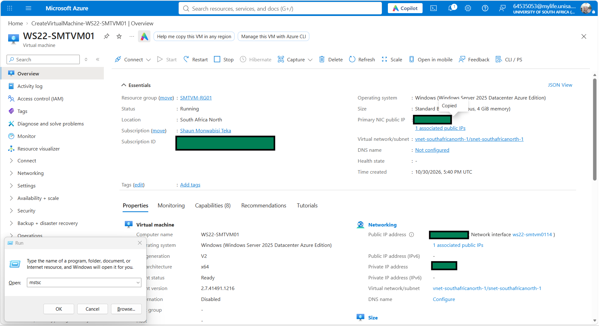

> **Figure 11:** Launching Remote Desktop Connection using the `mstsc` command.

---

## 12. Enter the VM Public IP Address

The Remote Desktop Connection client opened successfully.

I entered the public IP address assigned to the Azure Virtual Machine into the **Computer** field and started the connection.

```text
<PUBLIC-IP-REDACTED>
```

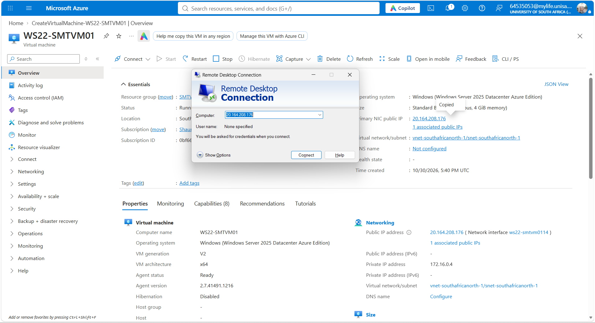

> **Figure 12:** Entering the Azure VM public IP address in Remote Desktop Connection.

> 🔒 The actual public IP address has been removed from this documentation for security purposes.

---

## 13. Authenticate to the Virtual Machine

I entered the administrator username and password that I created during the VM configuration.

After selecting **OK**, Remote Desktop presented a certificate identity warning.

Because this was my own newly created lab VM and I had verified the destination, I reviewed the warning and proceeded with the connection.

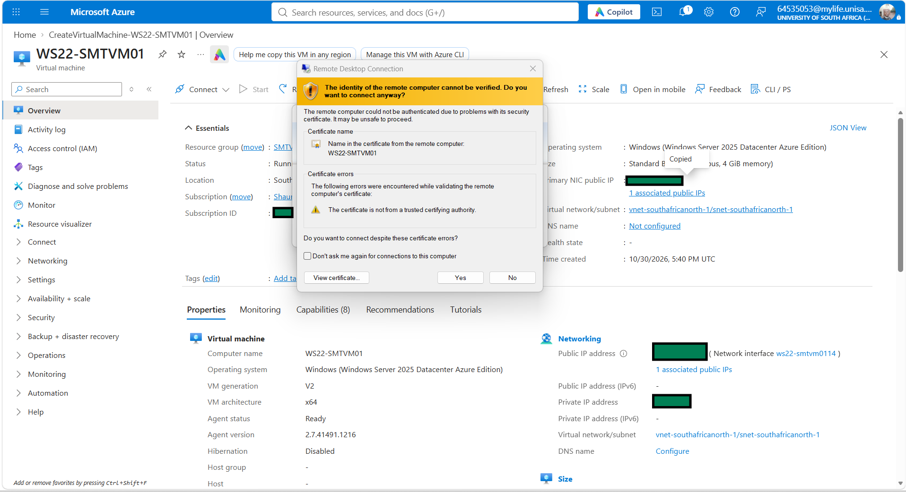

> **Figure 13:** Authenticating to the Azure Windows Server VM and reviewing the Remote Desktop certificate warning.

> ⚠️ Certificate warnings should not be ignored automatically. The destination, certificate information, and network connection should be verified before continuing.

---

## 14. Establish the RDP Session

The Remote Desktop session was established successfully.

I logged in to the Windows Server operating system running on the Azure Virtual Machine.

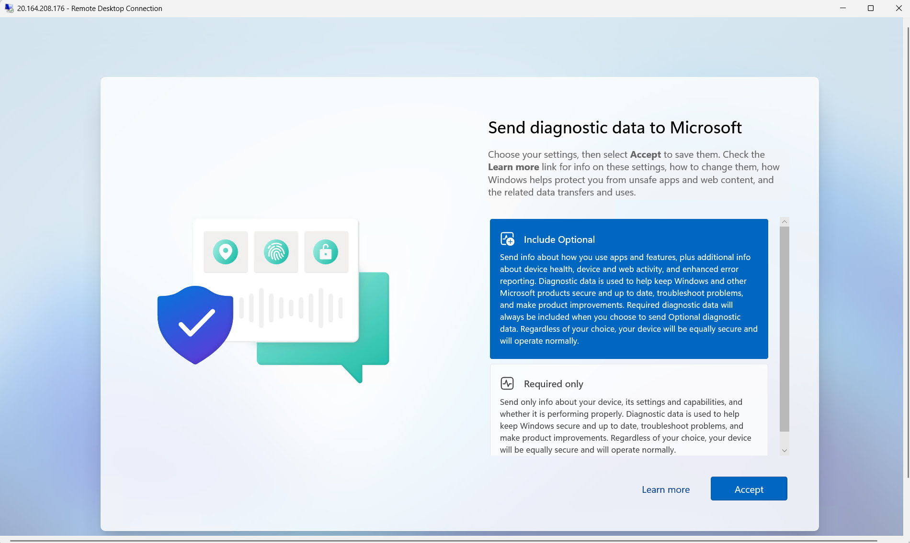

> **Figure 14:** Successful Remote Desktop session with the Azure Windows Server VM.

---

# 🪟 Exploring Windows Server 2025

## 15. Load Windows Server Manager

After signing in, **Windows Server Manager** loaded on the Virtual Machine.

Server Manager provides a central dashboard for reviewing and administering the Windows Server environment.

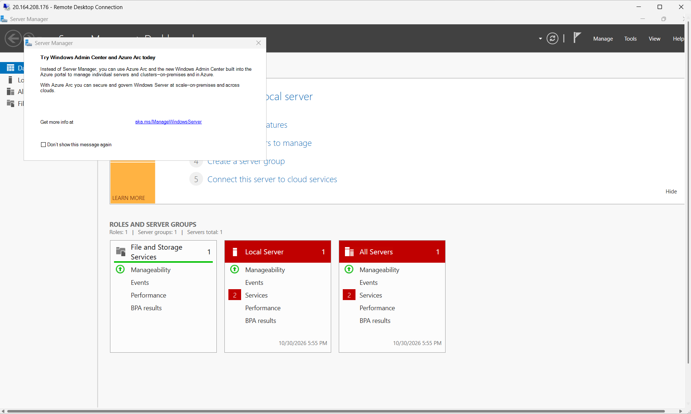

> **Figure 15:** Windows Server 2025 Server Manager successfully loaded.

---

## 16. Review the Server Dashboard

I reviewed the Server Manager dashboard to access the local server configuration, installed roles, services, and other management tools.

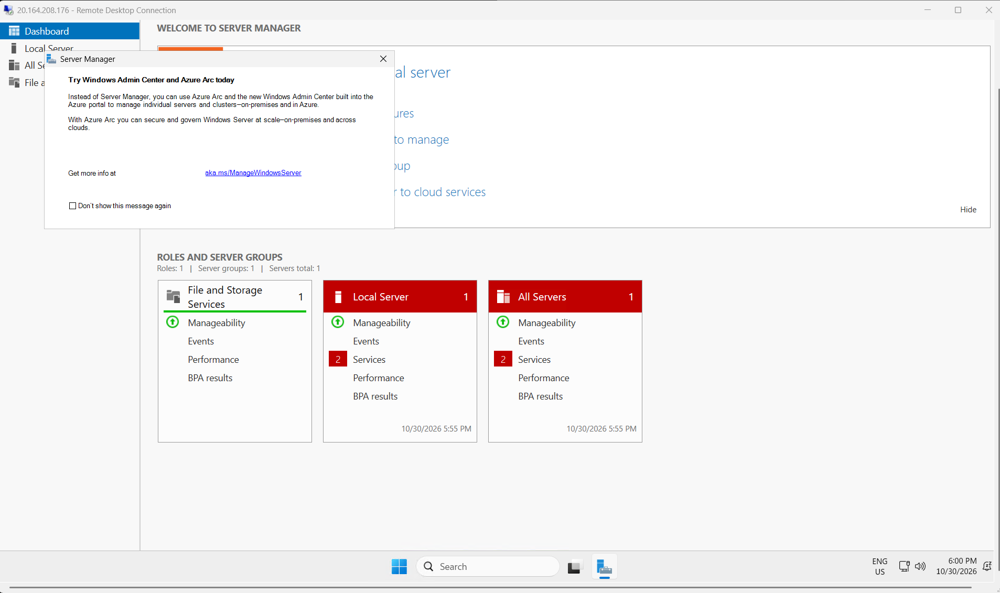

> **Figure 16:** Windows Server Manager dashboard on the deployed Azure VM.

---

## 17. Review Roles and Features

The Azure Virtual Machine can now be configured according to the server's intended purpose.

Windows Server roles and features can be installed in a similar manner to a Windows Server deployed in an on-premises environment.

The exact roles and services should be selected according to the requirements of the workload being hosted.

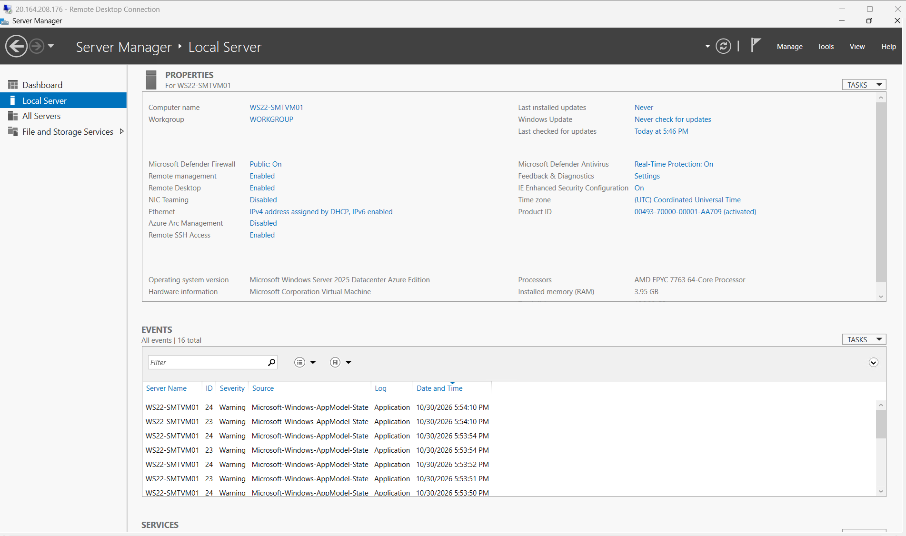

> **Figure 17:** Reviewing the option to add Windows Server roles and features.

---

# ⏹️ Stopping and Deallocating the VM

## 18. Shut Down the Windows Session

When the Virtual Machine is no longer required, I can shut down the Windows Server operating system and disconnect the Remote Desktop session.

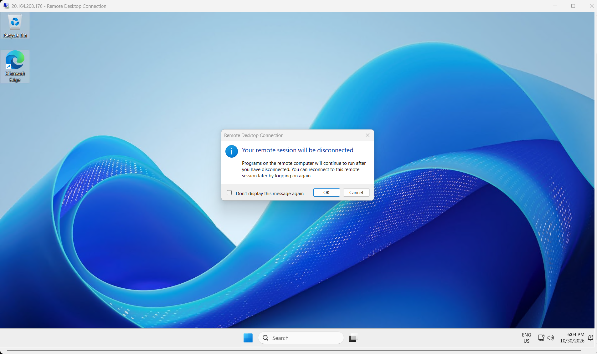

> **Figure 18:** Ending the Windows Server session when the VM is no longer required.

---

## 19. Stop the VM from Azure

I returned to the Azure Portal and selected **Stop** from the VM Overview page.

Stopping the VM through Azure allows the platform to deallocate its compute resources.

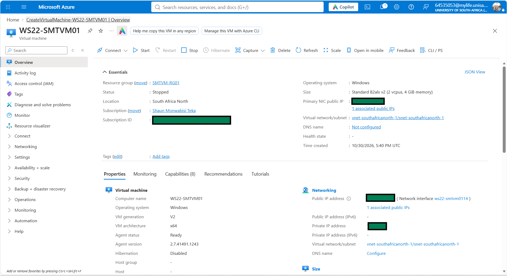

> **Figure 19:** Selecting “Stop” from the Azure VM Overview page.

---

## 20. Confirm VM Deallocation

Azure displayed a confirmation dialog before stopping the Virtual Machine.

I selected **Yes** to confirm that I wanted to stop and deallocate the VM.

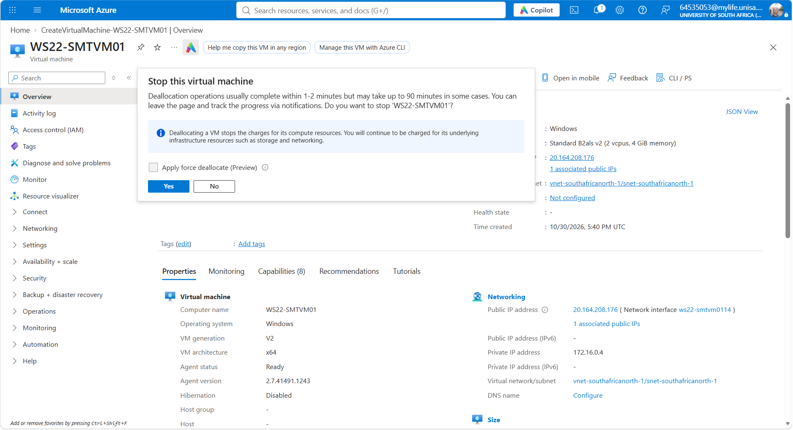

> **Figure 20:** Confirming that the Azure VM should be stopped and deallocated.

---

## 21. Verify the Deallocated Status

The Virtual Machine stopped successfully.

The VM status changed to:

```text
Stopped (deallocated)
```

This confirmed that the VM's compute resources had been deallocated.

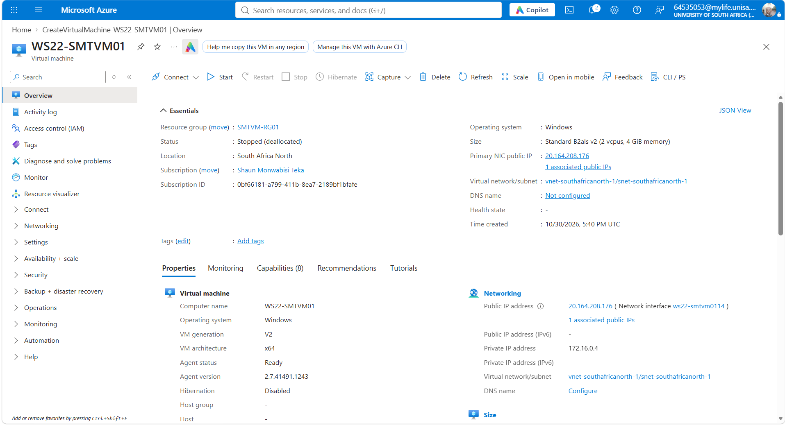

> **Figure 21:** Azure VM status successfully changed to “Stopped (deallocated).”

---

# 🗑️ Removing the Azure Resources

## 22. Open the Resource Group

When the environment is no longer required, the Resource Group can be used to review and remove the resources created for the lab.

I selected the Resource Group:

```text
SMTVM-RG01
```

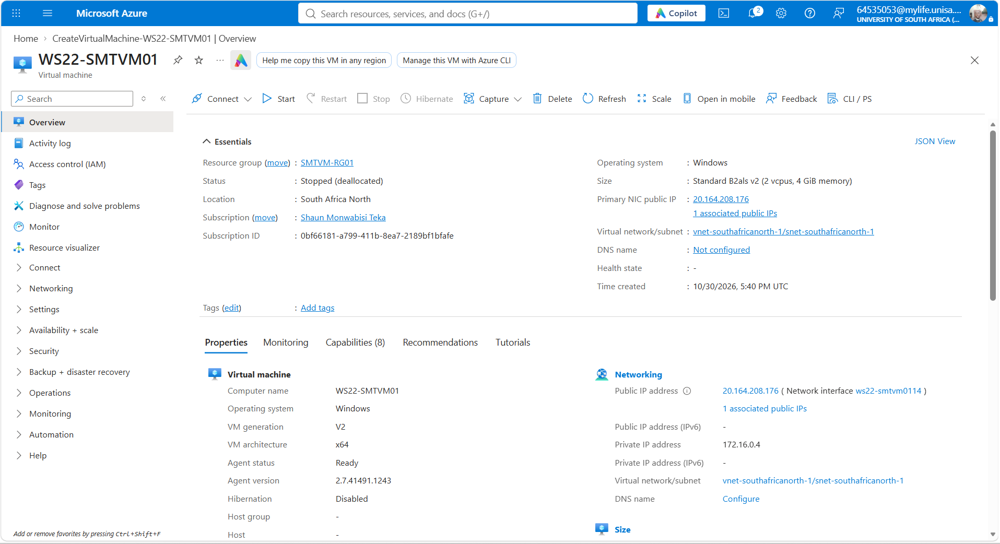

> **Figure 22:** Opening the `SMTVM-RG01` Resource Group.

---

## 23. Select Delete Resource Group

From the Resource Group Overview page, I selected **Delete resource group**.

Azure then opened a warning page explaining that deleting the Resource Group would also delete the resources contained inside it.

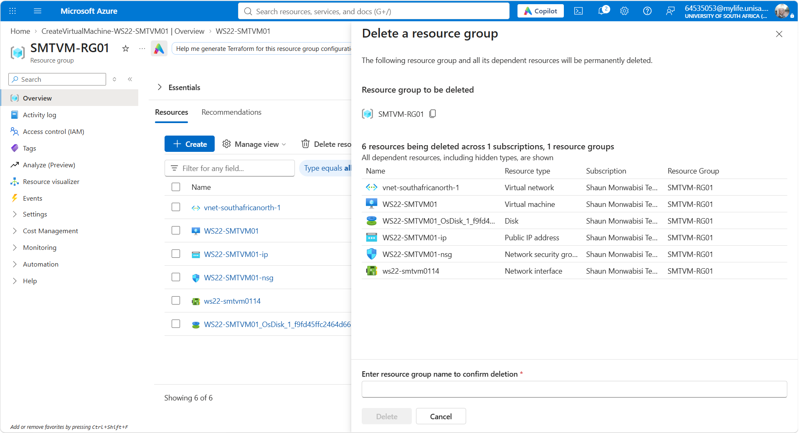

> **Figure 23:** Selecting “Delete resource group” from the Resource Group Overview page.

> ⚠️ Deleting a Resource Group is destructive. Always inspect the resources inside the group and confirm that none are still required before continuing.

---

## 24. Confirm Resource Group Deletion

To confirm the deletion request, I entered the Resource Group name:

```text
SMTVM-RG01
```

Azure displayed a final warning before the deletion could proceed.

The **Delete** option should only be selected after confirming that the Virtual Machine and all associated resources are no longer required.

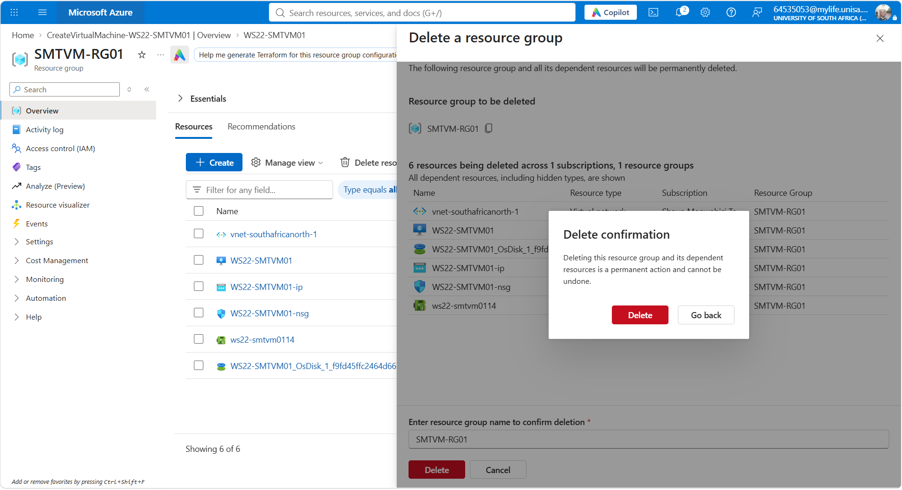

> **Figure 24:** Entering the Resource Group name and reviewing the final deletion warning.

---

# 🔐 Security Considerations

The following security considerations were identified during this project:

- Administrator credentials must not be published in GitHub.
- Public IP addresses should be hidden in public screenshots.
- RDP port `3389` should not be unnecessarily exposed to the public internet.
- Network Security Group rules should allow only the access required.
- Access should be restricted to approved source IP addresses where possible.
- Certificate warnings should be reviewed rather than automatically ignored.
- Azure credentials, subscription IDs, tenant IDs, and authentication details must be removed from screenshots.
- Resources should be stopped, deallocated, or deleted when they are no longer required.
- Resource Groups should be reviewed carefully before deletion.

---

# 🔧 Challenges and Troubleshooting

## Remote Desktop Certificate Warning

### Observation

A certificate identity warning appeared when I attempted to connect to the newly deployed Virtual Machine through Remote Desktop.

### Action Taken

I confirmed that I was connecting to my own lab VM using the expected public IP address before proceeding.

### Lesson Learned

Certificate warnings should be reviewed carefully. A warning should not be accepted unless the destination and connection details have been verified.

---

## Managing VM Usage

### Observation

Leaving a Virtual Machine running when it is not being used may result in continued resource usage and associated charges.

### Action Taken

After completing the lab, I stopped the Virtual Machine from the Azure Portal and confirmed that its status changed to:

```text
Stopped (deallocated)
```

### Lesson Learned

Azure resources should be monitored and managed actively. Lab resources should be stopped, deallocated, or removed when they are no longer required.

---

# 📚 What I Learned

Through this project, I gained practical experience with:

- Navigating the Microsoft Azure Portal
- Creating an Azure Resource Group
- Configuring an Azure Virtual Machine
- Selecting a Windows Server image
- Selecting an Azure VM size
- Using Trusted Launch security
- Configuring administrator credentials
- Understanding Network Security Groups
- Configuring RDP access on TCP port 3389
- Deploying Azure infrastructure
- Connecting to a Windows Server using Remote Desktop
- Using Windows Server Manager
- Stopping and deallocating an Azure VM
- Reviewing Resource Group deletion
- Protecting sensitive information in public documentation
